# Catalogue of the buttons of the large-screen television (design preview)

Generated 2026-11-12 from the design preview (`docs/tv-preview/large-screen-design.html`, simulated store, not deployed). **38 screens**, each with its picture and the buttons numbered on it. For every button the last column is yours: **Keep, Remove, Change** (say how) or **Add** (what is missing). Reply with the screen name and the number, for example "firmness #3: change the label to ...".

How to read the pictures: an **orange** frame with a number is a button of that screen; a **purple dashed** frame with a letter (A to E) is a button group that is on every screen and is listed once, in the next section. Everything is rounded, the blue buttons are the bright-blue family.

## Buttons that are on every screen (A to E)

### A. Tools (top right)

| Button | What it does today | Your decision |
|---|---|---|
| View Model Gallery | Opens or closes the product photographs inside the television | |
| Optimised Preview | Shows the television (Optimised Preview) | |
| Standard Product View | Shows the shop's own page without the television (Standard Product View) | |

### B. The fourteen topics (top of the television, two rows)

| Button | What it does today | Your decision |
|---|---|---|
| Discover | Opens the topic "Discover" at its first panel | |
| Firmness | Opens the topic "Firmness" at its first panel | |
| Comfort | Opens the topic "Comfort" at its first panel | |
| Height | Opens the topic "Height" at its first panel | |
| Covers | Opens the topic "Covers" at its first panel | |
| Benefits | Opens the topic "Benefits" at its first panel | |
| Support | Opens the topic "Support" at its first panel | |
| Adaptation | Opens the topic "Adaptation" at its first panel | |
| 7-Zone | Opens the topic "7-Zone" at its first panel | |
| Ventilation | Opens the topic "Ventilation" at its first panel | |
| Hygiene | Opens the topic "Hygiene" at its first panel | |
| Certifications | Opens the topic "Certifications" at its first panel | |
| Warranty | Opens the topic "Warranty" at its first panel | |
| Delivery | Opens the topic "Delivery" at its first panel | |

### C. The left menu: this topic's panels, and your order

The panels change with the topic:

| Topic | Panel buttons | Your decision |
|---|---|---|
| discover | Introduction · At a Glance | |
| firmness | Choose · Correct vs Softer · How It Works · Who It Is For | |
| comfort | What To Expect · Latex Behaviour | |
| height | Choose size · Choose depth · Why Height Matters | |
| covers | Choose cover · Cover System | |
| benefits | Origin · Why Latex | |
| support | Bearing Force · Support + Adaptation | |
| adaptation | Elasticity · How It Feels | |
| zones | Zone Map · Zone By Zone | |
| ventilation | Airflow · Why It Matters | |
| hygiene | Cleaner Sleep · Realistic Picture | |
| certs | Certifications · Where It Is Made | |
| warranty | Warranty + Gift · Conditions | |
| delivery | Made To Order · Your Botanic | |

Below the panels, always the same five order steps:

| Button | What it does today | Your decision |
|---|---|---|
| Size, chosen 150 × 210 cm | Goes to the order step "Size" | |
| Firmness, chosen Firm | Goes to the order step "Firmness" | |
| Depth, chosen 24 cm | Goes to the order step "Depth" | |
| Cover, chosen Cotton / Wool | Goes to the order step "Cover" | |
| Review | Goes to the order step "Review" | |

### D. Your selection (right): the four chips

| Button | What it does today | Your decision |
|---|---|---|
| size150 | Goes to the step where this is chosen | |
| firmnessFirm | Goes to the step where this is chosen | |
| depth24 | Goes to the step where this is chosen | |
| coverCotton | Goes to the step where this is chosen | |

### E. Add to Bag / Go to Checkout

| Button | What it does today | Your decision |
|---|---|---|
| Add to Bag / Go to Checkout (in "Your selection", and again below the television as the shop's own button) | One button with two faces: Add to Bag presses Ecwid's own button once all four choices are made; then it becomes Go to Checkout, which opens the shop's checkout; a changed choice turns it back into Add to Bag | |

## Screen by screen

| # | Screen | Own buttons |
|---|---|---|
| 1 | [Start: nothing chosen yet (Size)](#start) | 24 |
| 2 | [Size: the custom-size form open](#size-form) | 25 |
| 3 | [Size: chosen](#size-chosen) | 24 |
| 4 | [Firmness: nothing chosen, no weight or height](#firmness-empty) | 8 |
| 5 | [Firmness: weight and height set, guidance shown](#firmness) | 8 |
| 6 | [Depth](#depth) | 5 |
| 7 | [Cover: nothing chosen](#cover-none) | 6 |
| 8 | [Cover: one chosen](#cover) | 6 |
| 9 | [Review: all four chosen](#review) | 6 |
| 10 | [Review: after Add to Bag (Go to Checkout)](#review-bagged) | 6 |
| 11 | [Standard Product View (the shop's own page, stand-in)](#standard) | 13 |
| 12 | [View Model Gallery](#gallery) | 11 |
| 13 | [Discover · Introduction](#discover-intro) | 2 |
| 14 | [Discover · At a Glance](#discover-glance) | 3 |
| 15 | [Firmness · Correct vs Softer](#firmness-principle) | 8 |
| 16 | [Firmness · How It Works](#firmness-regulation) | 6 |
| 17 | [Firmness · Who It Is For](#firmness-who) | 5 |
| 18 | [Comfort · What To Expect](#comfort-expect) | 6 |
| 19 | [Comfort · Latex Behaviour](#comfort-behaviour) | 9 |
| 20 | [Height · Why Height Matters](#height-why) | 5 |
| 21 | [Covers · Cover System](#covers-system) | 6 |
| 22 | [Benefits · Origin](#benefits-origin) | 3 |
| 23 | [Benefits · Why Latex](#benefits-why) | 7 |
| 24 | [Support · Bearing Force](#support-bearing) | 3 |
| 25 | [Support · Support + Adaptation](#support-together) | 6 |
| 26 | [Adaptation · Elasticity](#adaptation-elasticity) | 3 |
| 27 | [Adaptation · How It Feels](#adaptation-feel) | 7 |
| 28 | [7-Zone · Zone Map](#zones-map) | 3 |
| 29 | [7-Zone · Zone By Zone](#zones-detail) | 6 |
| 30 | [Ventilation · Airflow](#ventilation-airflow) | 3 |
| 31 | [Ventilation · Why It Matters](#ventilation-sleep) | 5 |
| 32 | [Hygiene · Cleaner Sleep](#hygiene-clean) | 3 |
| 33 | [Hygiene · Realistic Picture](#hygiene-picture) | 5 |
| 34 | [Certifications · Certifications](#certs-bodies) | 3 |
| 35 | [Certifications · Where It Is Made](#certs-made) | 7 |
| 36 | [Warranty · Warranty + Gift](#warranty-cover) | 3 |
| 37 | [Warranty · Conditions](#warranty-conditions) | 5 |
| 38 | [Delivery · Made To Order](#delivery-made) | 5 |

### start

**Start: nothing chosen yet (Size)**

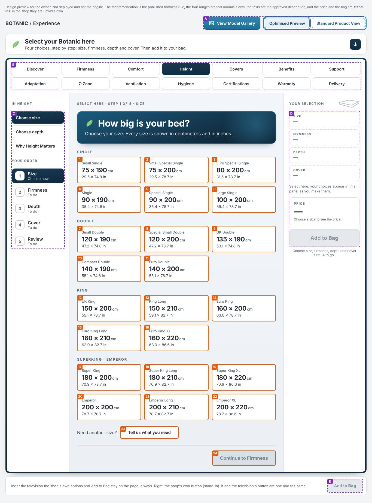

| No. | Button | Kind | What it does today | Leads to | Your decision |
|---|---|---|---|---|---|
| 1 | Small Single75 × 190cm29.5 × 74.8 in | Size choice | Chooses this size: sets Ecwid's own Size control | the same screen, size chosen | |
| 2 | Small Special Single75 × 200cm29.5 × 78.7 in | Size choice | Chooses this size: sets Ecwid's own Size control | the same screen, size chosen | |
| 3 | Euro Special Single80 × 200cm31.5 × 78.7 in | Size choice | Chooses this size: sets Ecwid's own Size control | the same screen, size chosen | |
| 4 | Single90 × 190cm35.4 × 74.8 in | Size choice | Chooses this size: sets Ecwid's own Size control | the same screen, size chosen | |
| 5 | Special Single90 × 200cm35.4 × 78.7 in | Size choice | Chooses this size: sets Ecwid's own Size control | the same screen, size chosen | |
| 6 | Large Single100 × 200cm39.4 × 78.7 in | Size choice | Chooses this size: sets Ecwid's own Size control | the same screen, size chosen | |
| 7 | Small Double120 × 190cm47.2 × 74.8 in | Size choice | Chooses this size: sets Ecwid's own Size control | the same screen, size chosen | |
| 8 | Special Small Double120 × 200cm47.2 × 78.7 in | Size choice | Chooses this size: sets Ecwid's own Size control | the same screen, size chosen | |
| 9 | UK Double135 × 190cm53.1 × 74.8 in | Size choice | Chooses this size: sets Ecwid's own Size control | the same screen, size chosen | |
| 10 | Compact Double140 × 190cm55.1 × 74.8 in | Size choice | Chooses this size: sets Ecwid's own Size control | the same screen, size chosen | |
| 11 | Euro Double140 × 200cm55.1 × 78.7 in | Size choice | Chooses this size: sets Ecwid's own Size control | the same screen, size chosen | |
| 12 | UK King150 × 200cm59.1 × 78.7 in | Size choice | Chooses this size: sets Ecwid's own Size control | the same screen, size chosen | |
| 13 | King Long150 × 210cm59.1 × 82.7 in | Size choice | Chooses this size: sets Ecwid's own Size control | the same screen, size chosen | |
| 14 | Euro King160 × 200cm63.0 × 78.7 in | Size choice | Chooses this size: sets Ecwid's own Size control | the same screen, size chosen | |
| 15 | Euro King Long160 × 210cm63.0 × 82.7 in | Size choice | Chooses this size: sets Ecwid's own Size control | the same screen, size chosen | |
| 16 | Euro King XL160 × 220cm63.0 × 86.6 in | Size choice | Chooses this size: sets Ecwid's own Size control | the same screen, size chosen | |
| 17 | Super King180 × 200cm70.9 × 78.7 in | Size choice | Chooses this size: sets Ecwid's own Size control | the same screen, size chosen | |
| 18 | Super King Long180 × 210cm70.9 × 82.7 in | Size choice | Chooses this size: sets Ecwid's own Size control | the same screen, size chosen | |
| 19 | Super King XL180 × 220cm70.9 × 86.6 in | Size choice | Chooses this size: sets Ecwid's own Size control | the same screen, size chosen | |
| 20 | Emperor200 × 200cm78.7 × 78.7 in | Size choice | Chooses this size: sets Ecwid's own Size control | the same screen, size chosen | |
| 21 | Emperor Long200 × 210cm78.7 × 82.7 in | Size choice | Chooses this size: sets Ecwid's own Size control | the same screen, size chosen | |
| 22 | Emperor XL200 × 220cm78.7 × 86.6 in | Size choice | Chooses this size: sets Ecwid's own Size control | the same screen, size chosen | |
| 23 | Tell us what you need | Custom size | Opens the contact form for another size | the form on this screen | |
| 24 | Continue to Firmness (off until its condition is met) | Continue | Goes to the next step of the order (disabled until this step is chosen) | the next step | |

### size-form

**Size: the custom-size form open**

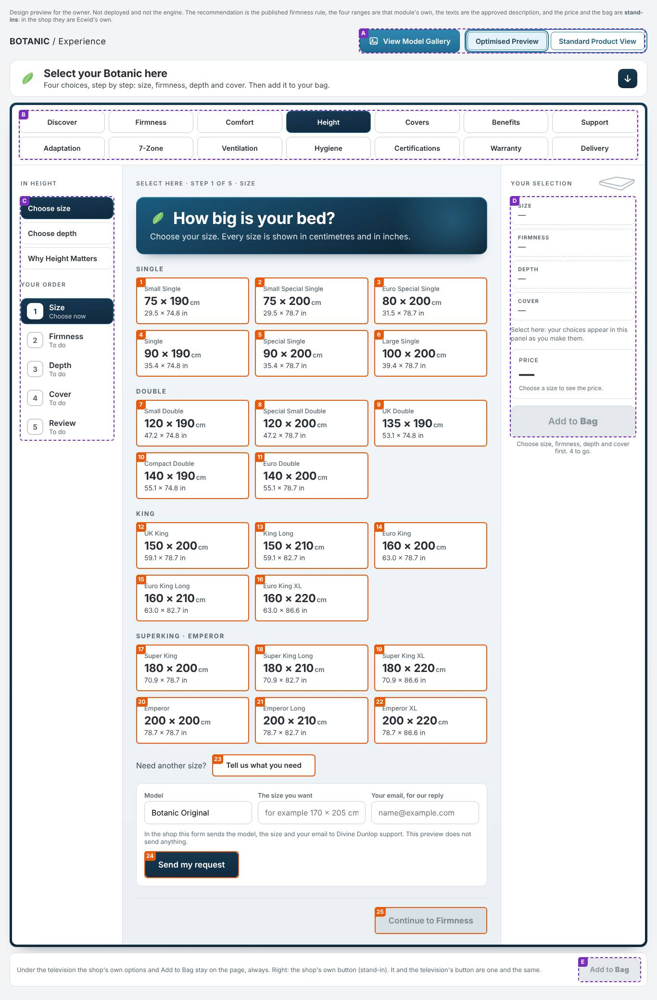

| No. | Button | Kind | What it does today | Leads to | Your decision |
|---|---|---|---|---|---|
| 1 | Small Single75 × 190cm29.5 × 74.8 in | Size choice | Chooses this size: sets Ecwid's own Size control | the same screen, size chosen | |
| 2 | Small Special Single75 × 200cm29.5 × 78.7 in | Size choice | Chooses this size: sets Ecwid's own Size control | the same screen, size chosen | |
| 3 | Euro Special Single80 × 200cm31.5 × 78.7 in | Size choice | Chooses this size: sets Ecwid's own Size control | the same screen, size chosen | |
| 4 | Single90 × 190cm35.4 × 74.8 in | Size choice | Chooses this size: sets Ecwid's own Size control | the same screen, size chosen | |
| 5 | Special Single90 × 200cm35.4 × 78.7 in | Size choice | Chooses this size: sets Ecwid's own Size control | the same screen, size chosen | |
| 6 | Large Single100 × 200cm39.4 × 78.7 in | Size choice | Chooses this size: sets Ecwid's own Size control | the same screen, size chosen | |
| 7 | Small Double120 × 190cm47.2 × 74.8 in | Size choice | Chooses this size: sets Ecwid's own Size control | the same screen, size chosen | |
| 8 | Special Small Double120 × 200cm47.2 × 78.7 in | Size choice | Chooses this size: sets Ecwid's own Size control | the same screen, size chosen | |
| 9 | UK Double135 × 190cm53.1 × 74.8 in | Size choice | Chooses this size: sets Ecwid's own Size control | the same screen, size chosen | |
| 10 | Compact Double140 × 190cm55.1 × 74.8 in | Size choice | Chooses this size: sets Ecwid's own Size control | the same screen, size chosen | |
| 11 | Euro Double140 × 200cm55.1 × 78.7 in | Size choice | Chooses this size: sets Ecwid's own Size control | the same screen, size chosen | |
| 12 | UK King150 × 200cm59.1 × 78.7 in | Size choice | Chooses this size: sets Ecwid's own Size control | the same screen, size chosen | |
| 13 | King Long150 × 210cm59.1 × 82.7 in | Size choice | Chooses this size: sets Ecwid's own Size control | the same screen, size chosen | |
| 14 | Euro King160 × 200cm63.0 × 78.7 in | Size choice | Chooses this size: sets Ecwid's own Size control | the same screen, size chosen | |
| 15 | Euro King Long160 × 210cm63.0 × 82.7 in | Size choice | Chooses this size: sets Ecwid's own Size control | the same screen, size chosen | |
| 16 | Euro King XL160 × 220cm63.0 × 86.6 in | Size choice | Chooses this size: sets Ecwid's own Size control | the same screen, size chosen | |
| 17 | Super King180 × 200cm70.9 × 78.7 in | Size choice | Chooses this size: sets Ecwid's own Size control | the same screen, size chosen | |
| 18 | Super King Long180 × 210cm70.9 × 82.7 in | Size choice | Chooses this size: sets Ecwid's own Size control | the same screen, size chosen | |
| 19 | Super King XL180 × 220cm70.9 × 86.6 in | Size choice | Chooses this size: sets Ecwid's own Size control | the same screen, size chosen | |
| 20 | Emperor200 × 200cm78.7 × 78.7 in | Size choice | Chooses this size: sets Ecwid's own Size control | the same screen, size chosen | |
| 21 | Emperor Long200 × 210cm78.7 × 82.7 in | Size choice | Chooses this size: sets Ecwid's own Size control | the same screen, size chosen | |
| 22 | Emperor XL200 × 220cm78.7 × 86.6 in | Size choice | Chooses this size: sets Ecwid's own Size control | the same screen, size chosen | |
| 23 | Tell us what you need | Custom size | Opens the contact form for another size | the form on this screen | |
| 24 | Send my request | Send | Sends the model, the size wanted and the email to Divine Dunlop support (the preview sends nothing) | a confirmation | |
| 25 | Continue to Firmness (off until its condition is met) | Continue | Goes to the next step of the order (disabled until this step is chosen) | the next step | |

### size-chosen

**Size: chosen**

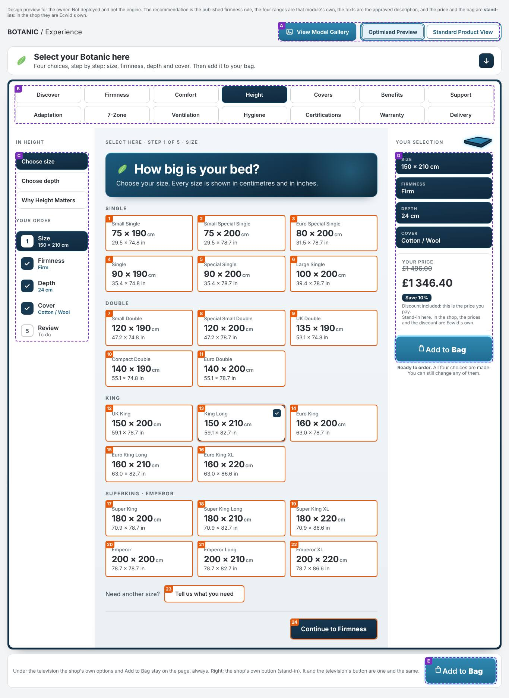

| No. | Button | Kind | What it does today | Leads to | Your decision |
|---|---|---|---|---|---|
| 1 | Small Single75 × 190cm29.5 × 74.8 in | Size choice | Chooses this size: sets Ecwid's own Size control | the same screen, size chosen | |
| 2 | Small Special Single75 × 200cm29.5 × 78.7 in | Size choice | Chooses this size: sets Ecwid's own Size control | the same screen, size chosen | |
| 3 | Euro Special Single80 × 200cm31.5 × 78.7 in | Size choice | Chooses this size: sets Ecwid's own Size control | the same screen, size chosen | |
| 4 | Single90 × 190cm35.4 × 74.8 in | Size choice | Chooses this size: sets Ecwid's own Size control | the same screen, size chosen | |
| 5 | Special Single90 × 200cm35.4 × 78.7 in | Size choice | Chooses this size: sets Ecwid's own Size control | the same screen, size chosen | |
| 6 | Large Single100 × 200cm39.4 × 78.7 in | Size choice | Chooses this size: sets Ecwid's own Size control | the same screen, size chosen | |
| 7 | Small Double120 × 190cm47.2 × 74.8 in | Size choice | Chooses this size: sets Ecwid's own Size control | the same screen, size chosen | |
| 8 | Special Small Double120 × 200cm47.2 × 78.7 in | Size choice | Chooses this size: sets Ecwid's own Size control | the same screen, size chosen | |
| 9 | UK Double135 × 190cm53.1 × 74.8 in | Size choice | Chooses this size: sets Ecwid's own Size control | the same screen, size chosen | |
| 10 | Compact Double140 × 190cm55.1 × 74.8 in | Size choice | Chooses this size: sets Ecwid's own Size control | the same screen, size chosen | |
| 11 | Euro Double140 × 200cm55.1 × 78.7 in | Size choice | Chooses this size: sets Ecwid's own Size control | the same screen, size chosen | |
| 12 | UK King150 × 200cm59.1 × 78.7 in | Size choice | Chooses this size: sets Ecwid's own Size control | the same screen, size chosen | |
| 13 | King Long150 × 210cm59.1 × 82.7 in | Size choice | Chooses this size: sets Ecwid's own Size control | the same screen, size chosen | |
| 14 | Euro King160 × 200cm63.0 × 78.7 in | Size choice | Chooses this size: sets Ecwid's own Size control | the same screen, size chosen | |
| 15 | Euro King Long160 × 210cm63.0 × 82.7 in | Size choice | Chooses this size: sets Ecwid's own Size control | the same screen, size chosen | |
| 16 | Euro King XL160 × 220cm63.0 × 86.6 in | Size choice | Chooses this size: sets Ecwid's own Size control | the same screen, size chosen | |
| 17 | Super King180 × 200cm70.9 × 78.7 in | Size choice | Chooses this size: sets Ecwid's own Size control | the same screen, size chosen | |
| 18 | Super King Long180 × 210cm70.9 × 82.7 in | Size choice | Chooses this size: sets Ecwid's own Size control | the same screen, size chosen | |
| 19 | Super King XL180 × 220cm70.9 × 86.6 in | Size choice | Chooses this size: sets Ecwid's own Size control | the same screen, size chosen | |
| 20 | Emperor200 × 200cm78.7 × 78.7 in | Size choice | Chooses this size: sets Ecwid's own Size control | the same screen, size chosen | |
| 21 | Emperor Long200 × 210cm78.7 × 82.7 in | Size choice | Chooses this size: sets Ecwid's own Size control | the same screen, size chosen | |
| 22 | Emperor XL200 × 220cm78.7 × 86.6 in | Size choice | Chooses this size: sets Ecwid's own Size control | the same screen, size chosen | |
| 23 | Tell us what you need | Custom size | Opens the contact form for another size | the form on this screen | |
| 24 | Continue to Firmness | Continue | Goes to the next step of the order (disabled until this step is chosen) | the next step | |

### firmness-empty

**Firmness: nothing chosen, no weight or height**

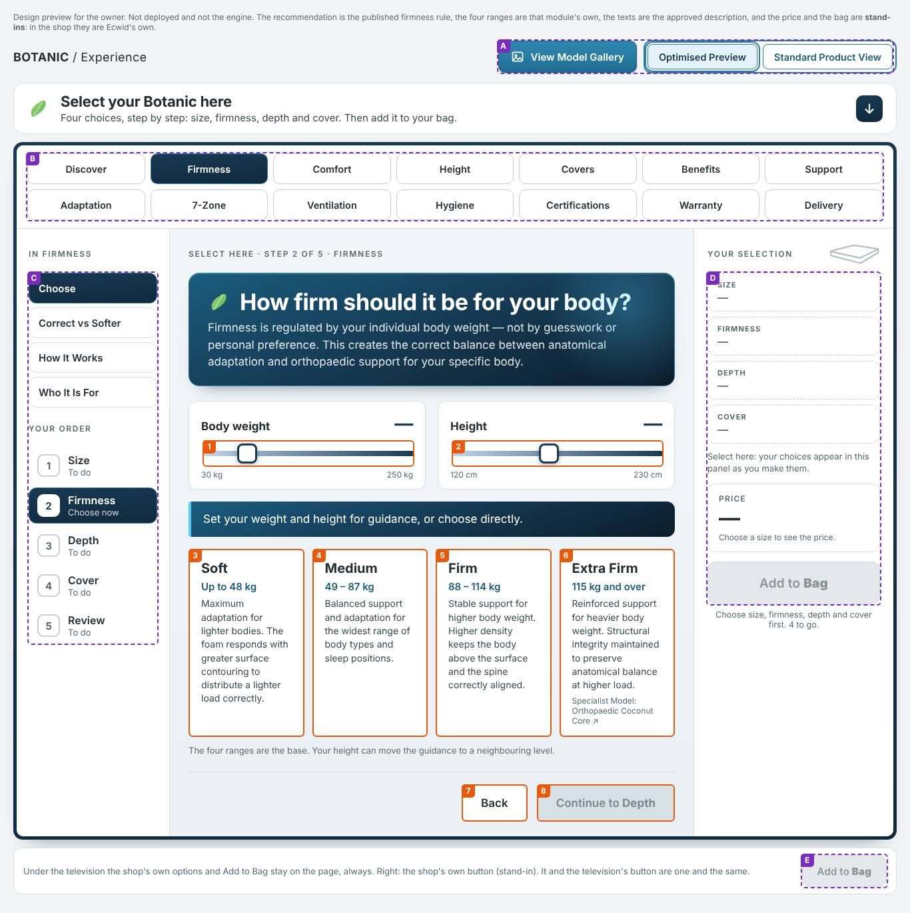

| No. | Button | Kind | What it does today | Leads to | Your decision |
|---|---|---|---|---|---|
| 1 | 70 | Slider | Sets body weight; the guidance follows; it never navigates | the guidance on this screen | |
| 2 | 170 | Slider | Sets height; the guidance follows; it never navigates | the guidance on this screen | |
| 3 | SoftUp to 48 kgMaximum adaptation for lighter bodies. The fo | Firmness choice | Chooses this firmness: sets Ecwid's own Firmness control | the same screen, firmness chosen | |
| 4 | Medium49 – 87 kgBalanced support and adaptation for the wide | Firmness choice | Chooses this firmness: sets Ecwid's own Firmness control | the same screen, firmness chosen | |
| 5 | Firm88 – 114 kgStable support for higher body weight. Higher | Firmness choice | Chooses this firmness: sets Ecwid's own Firmness control | the same screen, firmness chosen | |
| 6 | Extra Firm, specialist model Orthopaedic Coconut Core, opens | Link | Opens the specialist model (Orthopaedic Coconut Core) in its own product page, only when tapped | the specialist product page | |
| 7 | Back | Back | Goes to the previous step of the order | the previous step | |
| 8 | Continue to Depth (off until its condition is met) | Continue | Goes to the next step of the order (disabled until this step is chosen) | the next step | |

### firmness

**Firmness: weight and height set, guidance shown**

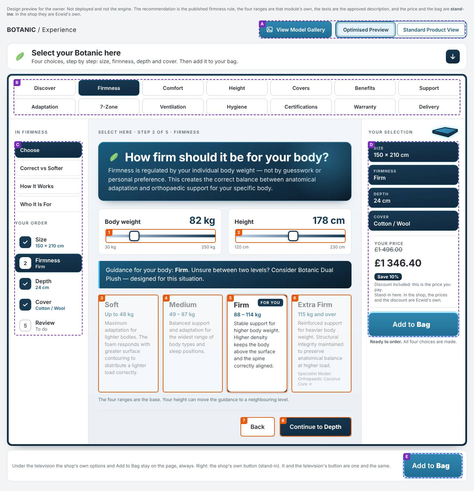

| No. | Button | Kind | What it does today | Leads to | Your decision |
|---|---|---|---|---|---|
| 1 | 82 | Slider | Sets body weight; the guidance follows; it never navigates | the guidance on this screen | |
| 2 | 178 | Slider | Sets height; the guidance follows; it never navigates | the guidance on this screen | |
| 3 | SoftUp to 48 kgMaximum adaptation for lighter bodies. The fo | Firmness choice | Chooses this firmness: sets Ecwid's own Firmness control | the same screen, firmness chosen | |
| 4 | Medium49 – 87 kgBalanced support and adaptation for the wide | Firmness choice | Chooses this firmness: sets Ecwid's own Firmness control | the same screen, firmness chosen | |
| 5 | For youFirm88 – 114 kgStable support for higher body weight. | Firmness choice | Chooses this firmness: sets Ecwid's own Firmness control | the same screen, firmness chosen | |
| 6 | Extra Firm, specialist model Orthopaedic Coconut Core, opens | Link | Opens the specialist model (Orthopaedic Coconut Core) in its own product page, only when tapped | the specialist product page | |
| 7 | Back | Back | Goes to the previous step of the order | the previous step | |
| 8 | Continue to Depth | Continue | Goes to the next step of the order (disabled until this step is chosen) | the next step | |

### depth

**Depth**

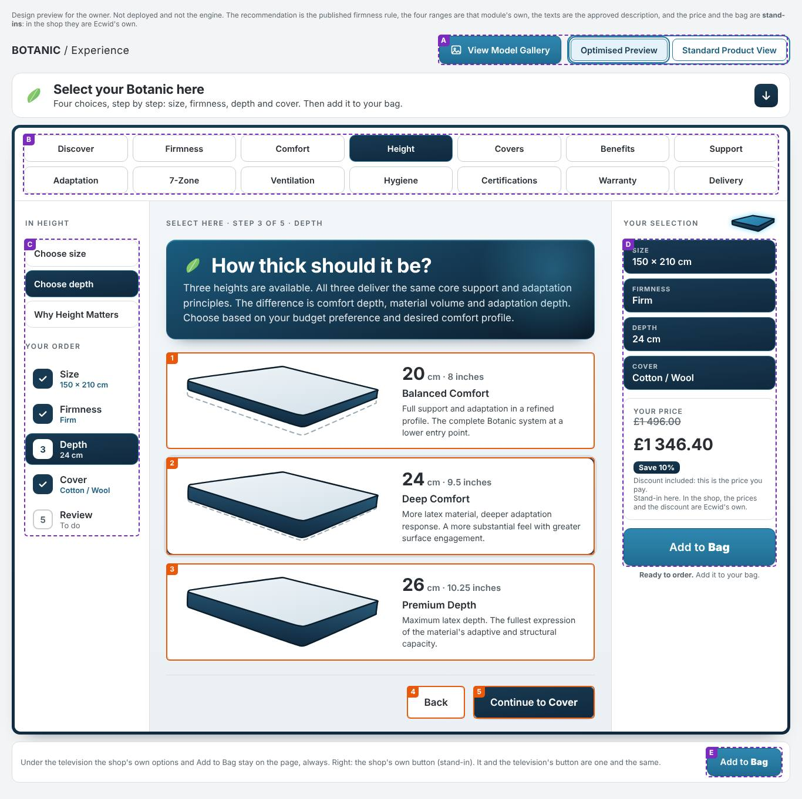

| No. | Button | Kind | What it does today | Leads to | Your decision |
|---|---|---|---|---|---|
| 1 | 20cm · 8 inchesBalanced ComfortFull support and adaptation i | Depth choice | Chooses this depth: sets Ecwid's own Depth control | the same screen, depth chosen | |
| 2 | 24cm · 9.5 inchesDeep ComfortMore latex material, deeper ada | Depth choice | Chooses this depth: sets Ecwid's own Depth control | the same screen, depth chosen | |
| 3 | 26cm · 10.25 inchesPremium DepthMaximum latex depth. The ful | Depth choice | Chooses this depth: sets Ecwid's own Depth control | the same screen, depth chosen | |
| 4 | Back | Back | Goes to the previous step of the order | the previous step | |
| 5 | Continue to Cover | Continue | Goes to the next step of the order (disabled until this step is chosen) | the next step | |

### cover-none

**Cover: nothing chosen**

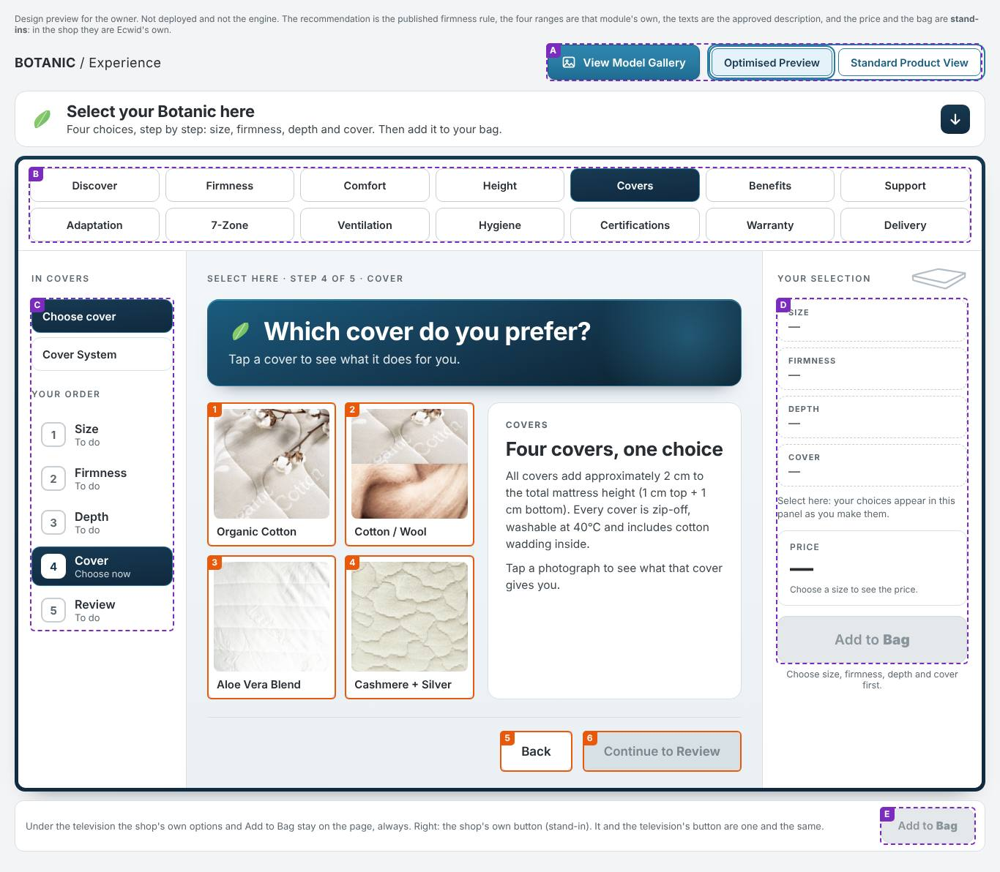

| No. | Button | Kind | What it does today | Leads to | Your decision |
|---|---|---|---|---|---|
| 1 | Organic Cotton | Cover choice | Chooses this cover: sets Ecwid's own Covers control and shows its information | the same screen, cover chosen | |
| 2 | Double-Sided Cotton / Wool | Cover choice | Chooses this cover: sets Ecwid's own Covers control and shows its information | the same screen, cover chosen | |
| 3 | Aloe Vera Blend | Cover choice | Chooses this cover: sets Ecwid's own Covers control and shows its information | the same screen, cover chosen | |
| 4 | Cashmere + Silver Ions | Cover choice | Chooses this cover: sets Ecwid's own Covers control and shows its information | the same screen, cover chosen | |
| 5 | Back | Back | Goes to the previous step of the order | the previous step | |
| 6 | Continue to Review (off until its condition is met) | Continue | Goes to the next step of the order (disabled until this step is chosen) | the next step | |

### cover

**Cover: one chosen**

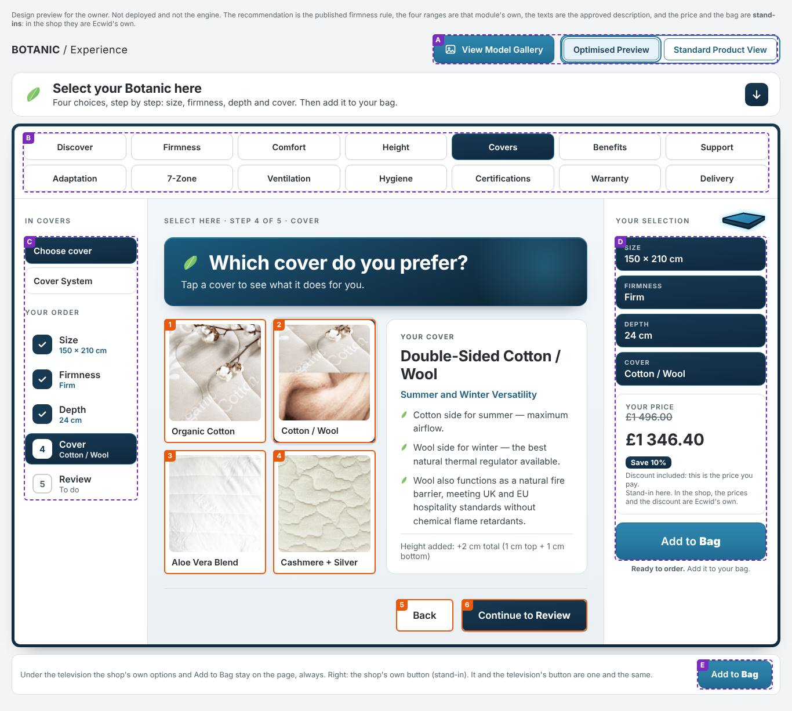

| No. | Button | Kind | What it does today | Leads to | Your decision |
|---|---|---|---|---|---|
| 1 | Organic Cotton | Cover choice | Chooses this cover: sets Ecwid's own Covers control and shows its information | the same screen, cover chosen | |
| 2 | Double-Sided Cotton / Wool | Cover choice | Chooses this cover: sets Ecwid's own Covers control and shows its information | the same screen, cover chosen | |
| 3 | Aloe Vera Blend | Cover choice | Chooses this cover: sets Ecwid's own Covers control and shows its information | the same screen, cover chosen | |
| 4 | Cashmere + Silver Ions | Cover choice | Chooses this cover: sets Ecwid's own Covers control and shows its information | the same screen, cover chosen | |
| 5 | Back | Back | Goes to the previous step of the order | the previous step | |
| 6 | Continue to Review | Continue | Goes to the next step of the order (disabled until this step is chosen) | the next step | |

### review

**Review: all four chosen**

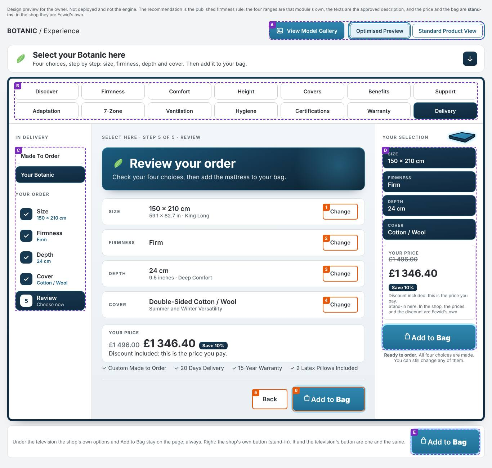

| No. | Button | Kind | What it does today | Leads to | Your decision |
|---|---|---|---|---|---|
| 1 | Change | Change | Goes back to that step to change the choice | that step | |
| 2 | Change | Change | Goes back to that step to change the choice | that step | |
| 3 | Change | Change | Goes back to that step to change the choice | that step | |
| 4 | Change | Change | Goes back to that step to change the choice | that step | |
| 5 | Back | Back | Goes to the previous step of the order | the previous step | |
| 6 | Add to Bag | Add to Bag | Presses Ecwid's own Add to Bag (disabled until size, firmness, depth and cover are chosen) | the same button turns into Go to Checkout | |

### review-bagged

**Review: after Add to Bag (Go to Checkout)**

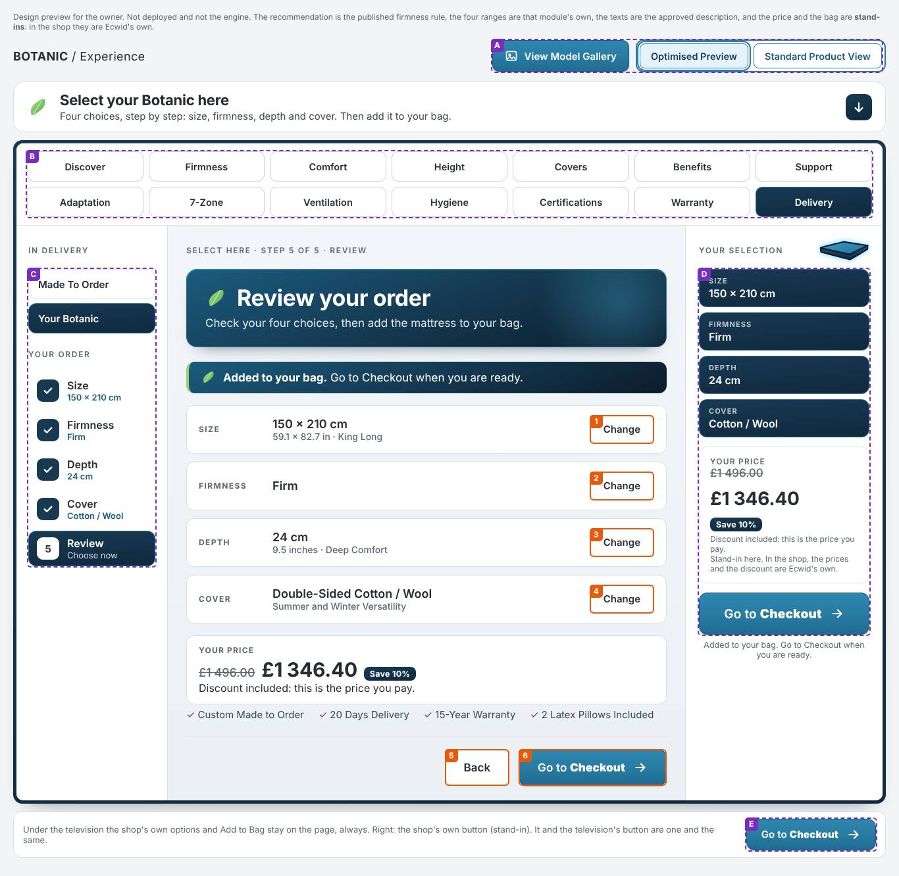

| No. | Button | Kind | What it does today | Leads to | Your decision |
|---|---|---|---|---|---|
| 1 | Change | Change | Goes back to that step to change the choice | that step | |
| 2 | Change | Change | Goes back to that step to change the choice | that step | |
| 3 | Change | Change | Goes back to that step to change the choice | that step | |
| 4 | Change | Change | Goes back to that step to change the choice | that step | |
| 5 | Back | Back | Goes to the previous step of the order | the previous step | |
| 6 | Go to Checkout | Go to Checkout | Opens the shopping cart, built from the four choices and the promotion; the e-mail is entered there, then checkout | the shopping cart | |

### standard

**Standard Product View (the shop's own page, stand-in)**

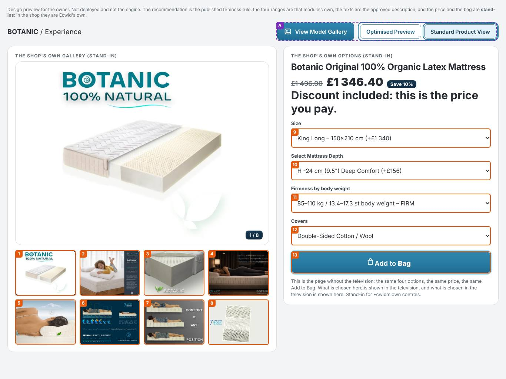

| No. | Button | Kind | What it does today | Leads to | Your decision |
|---|---|---|---|---|---|
| 1 | Photograph 1 | Photograph | Shows this photograph large | the large photograph | |
| 2 | Photograph 2 | Photograph | Shows this photograph large | the large photograph | |
| 3 | Photograph 3 | Photograph | Shows this photograph large | the large photograph | |
| 4 | Photograph 4 | Photograph | Shows this photograph large | the large photograph | |
| 5 | Photograph 5 | Photograph | Shows this photograph large | the large photograph | |
| 6 | Photograph 6 | Photograph | Shows this photograph large | the large photograph | |
| 7 | Photograph 7 | Photograph | Shows this photograph large | the large photograph | |
| 8 | Photograph 8 | Photograph | Shows this photograph large | the large photograph | |
| 9 | Please chooseSmall Single 75x190 cm./ 29.5” x 74.8” (+£788)S | Option menu | The shop's own option menu (stand-in): changes the same selection as the television | the television shows the same choice | |
| 10 | Please chooseH- 20 cm (8”) Balanced ComfortH -24 cm (9.5”) D | Option menu | The shop's own option menu (stand-in): changes the same selection as the television | the television shows the same choice | |
| 11 | Please chooseUp to 47 kg / up to 7.4 st body weight – SOFT48 | Option menu | The shop's own option menu (stand-in): changes the same selection as the television | the television shows the same choice | |
| 12 | Please chooseOrganic CottonDouble-Sided Cotton / WoolAloe Ve | Option menu | The shop's own option menu (stand-in): changes the same selection as the television | the television shows the same choice | |
| 13 | Add to Bag | Add to Bag | Presses Ecwid's own Add to Bag (disabled until size, firmness, depth and cover are chosen) | the same button turns into Go to Checkout | |

### gallery

**View Model Gallery**

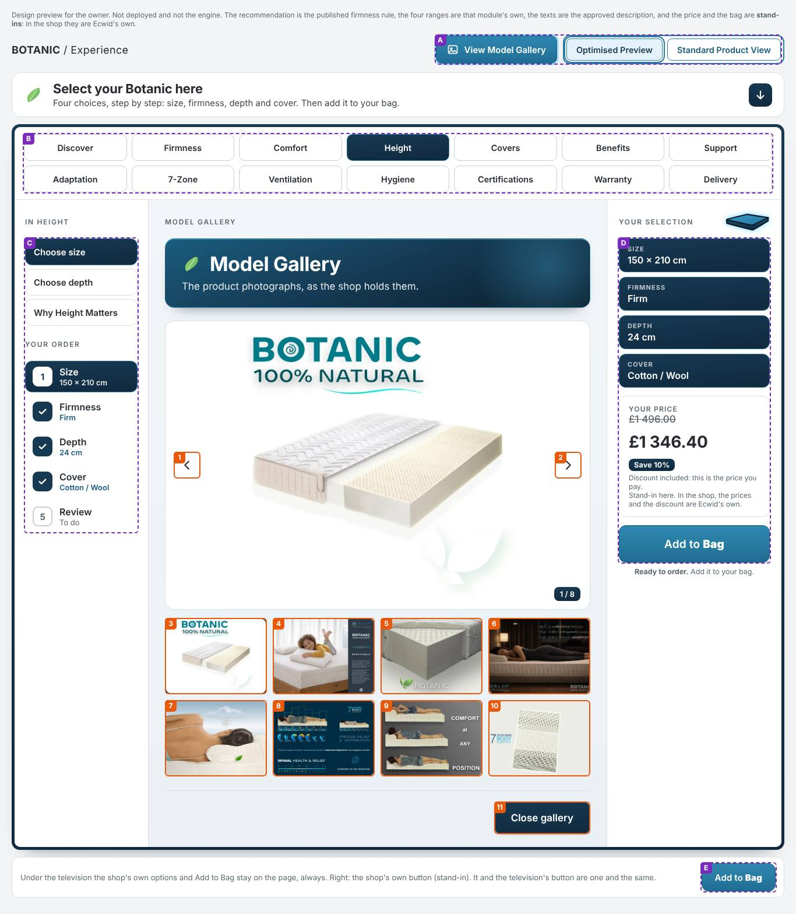

| No. | Button | Kind | What it does today | Leads to | Your decision |
|---|---|---|---|---|---|
| 1 | Previous photograph | Arrow | Shows the previous or next photograph | another photograph | |
| 2 | Next photograph | Arrow | Shows the previous or next photograph | another photograph | |
| 3 | Photograph 1 | Photograph | Shows this photograph large | the large photograph | |
| 4 | Photograph 2 | Photograph | Shows this photograph large | the large photograph | |
| 5 | Photograph 3 | Photograph | Shows this photograph large | the large photograph | |
| 6 | Photograph 4 | Photograph | Shows this photograph large | the large photograph | |
| 7 | Photograph 5 | Photograph | Shows this photograph large | the large photograph | |
| 8 | Photograph 6 | Photograph | Shows this photograph large | the large photograph | |
| 9 | Photograph 7 | Photograph | Shows this photograph large | the large photograph | |
| 10 | Photograph 8 | Photograph | Shows this photograph large | the large photograph | |
| 11 | Close gallery | Gallery | Closes the gallery and returns to where the customer was | the gallery / back | |

### discover-intro

**Discover · Introduction**

| No. | Button | Kind | What it does today | Leads to | Your decision |
|---|---|---|---|---|---|
| 1 | Select your Botanic | Select your Botanic | Goes to step 1 of the order (Size) | that step | |
| 2 | Next: At a Glance | Next | Goes to the next panel of the whole presentation | the next panel | |

### discover-glance

**Discover · At a Glance**

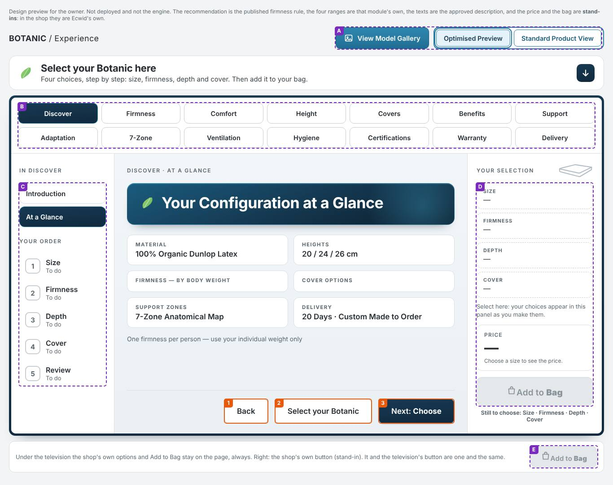

| No. | Button | Kind | What it does today | Leads to | Your decision |
|---|---|---|---|---|---|
| 1 | Back | Back | Goes to the previous panel of the whole presentation | the previous panel | |
| 2 | Select your Botanic | Select your Botanic | Goes to step 1 of the order (Size) | that step | |
| 3 | Next: Choose | Next | Goes to the next panel of the whole presentation | the next panel | |

### firmness-principle

**Firmness · Correct vs Softer**

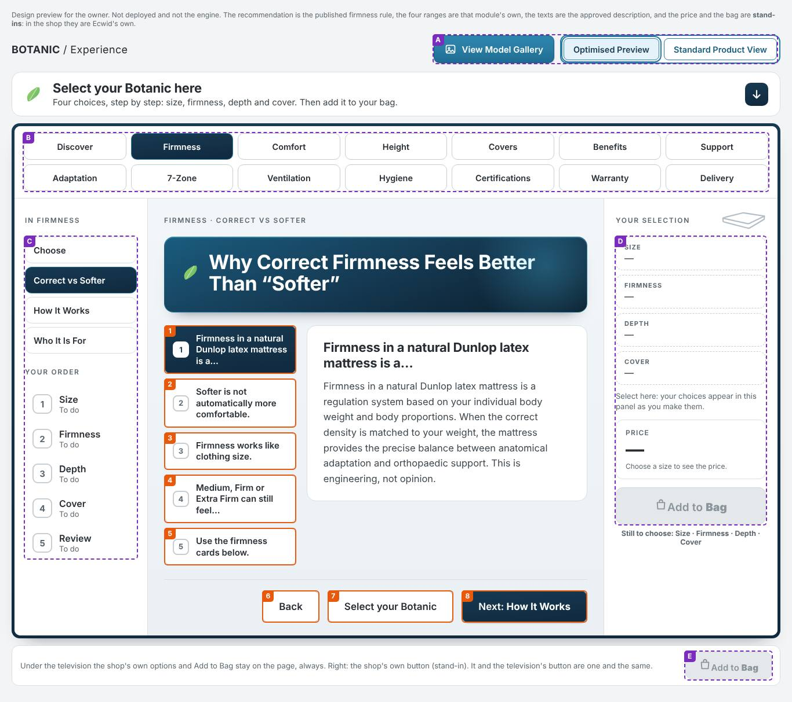

| No. | Button | Kind | What it does today | Leads to | Your decision |
|---|---|---|---|---|---|
| 1 | 1Firmness in a natural Dunlop latex mattress is a… | Text part | Shows this part of the text on the right | that part of the text | |
| 2 | 2Softer is not automatically more comfortable. | Text part | Shows this part of the text on the right | that part of the text | |
| 3 | 3Firmness works like clothing size. | Text part | Shows this part of the text on the right | that part of the text | |
| 4 | 4Medium, Firm or Extra Firm can still feel… | Text part | Shows this part of the text on the right | that part of the text | |
| 5 | 5Use the firmness cards below. | Text part | Shows this part of the text on the right | that part of the text | |
| 6 | Back | Back | Goes to the previous panel of the whole presentation | the previous panel | |
| 7 | Select your Botanic | Select your Botanic | Goes to step 1 of the order (Size) | that step | |
| 8 | Next: How It Works | Next | Goes to the next panel of the whole presentation | the next panel | |

### firmness-regulation

**Firmness · How It Works**

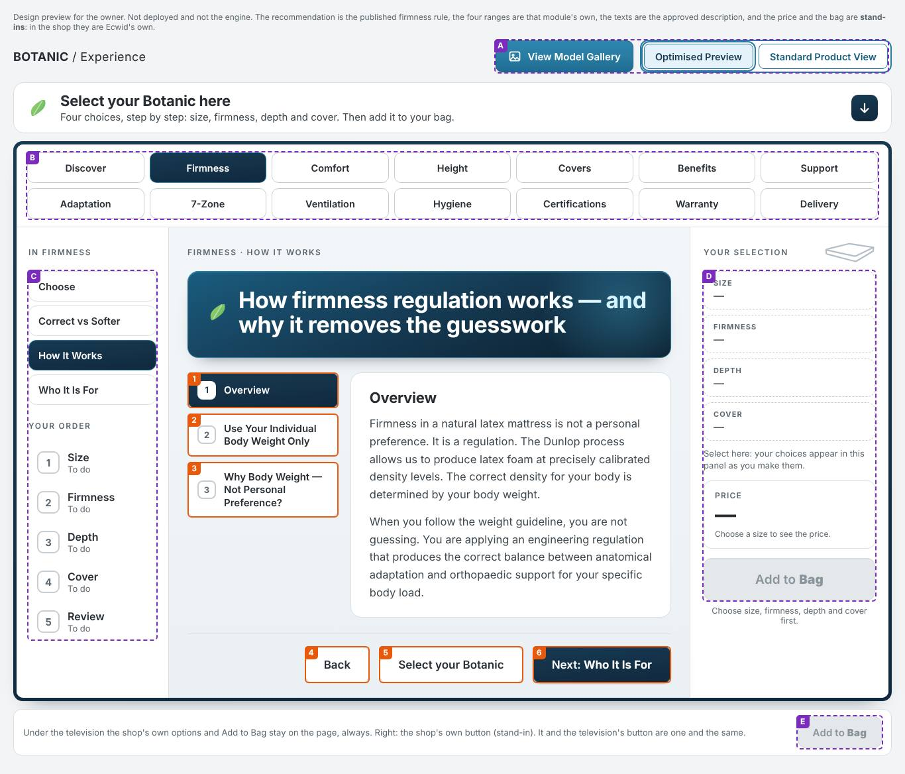

| No. | Button | Kind | What it does today | Leads to | Your decision |
|---|---|---|---|---|---|
| 1 | 1Overview | Text part | Shows this part of the text on the right | that part of the text | |
| 2 | 2Use Your Individual Body Weight Only | Text part | Shows this part of the text on the right | that part of the text | |
| 3 | 3Why Body Weight — Not Personal Preference? | Text part | Shows this part of the text on the right | that part of the text | |
| 4 | Back | Back | Goes to the previous panel of the whole presentation | the previous panel | |
| 5 | Select your Botanic | Select your Botanic | Goes to step 1 of the order (Size) | that step | |
| 6 | Next: Who It Is For | Next | Goes to the next panel of the whole presentation | the next panel | |

### firmness-who

**Firmness · Who It Is For**

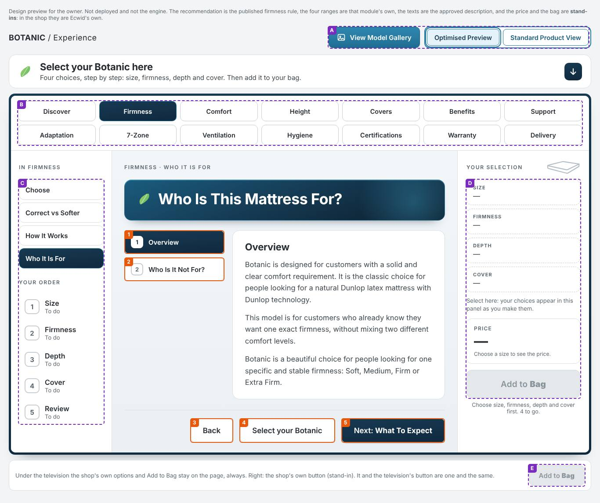

| No. | Button | Kind | What it does today | Leads to | Your decision |
|---|---|---|---|---|---|
| 1 | 1Overview | Text part | Shows this part of the text on the right | that part of the text | |
| 2 | 2Who Is It Not For? | Text part | Shows this part of the text on the right | that part of the text | |
| 3 | Back | Back | Goes to the previous panel of the whole presentation | the previous panel | |
| 4 | Select your Botanic | Select your Botanic | Goes to step 1 of the order (Size) | that step | |
| 5 | Next: What To Expect | Next | Goes to the next panel of the whole presentation | the next panel | |

### comfort-expect

**Comfort · What To Expect**

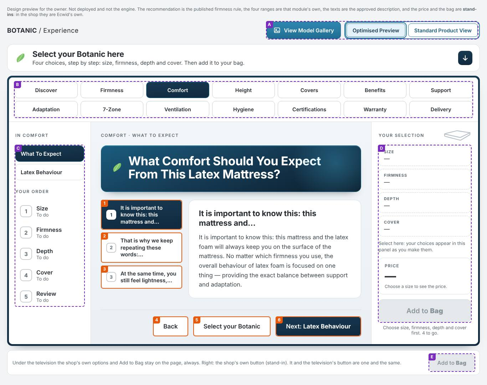

| No. | Button | Kind | What it does today | Leads to | Your decision |
|---|---|---|---|---|---|
| 1 | 1It is important to know this: this mattress and… | Text part | Shows this part of the text on the right | that part of the text | |
| 2 | 2That is why we keep repeating these words:… | Text part | Shows this part of the text on the right | that part of the text | |
| 3 | 3At the same time, you still feel lightness,… | Text part | Shows this part of the text on the right | that part of the text | |
| 4 | Back | Back | Goes to the previous panel of the whole presentation | the previous panel | |
| 5 | Select your Botanic | Select your Botanic | Goes to step 1 of the order (Size) | that step | |
| 6 | Next: Latex Behaviour | Next | Goes to the next panel of the whole presentation | the next panel | |

### comfort-behaviour

**Comfort · Latex Behaviour**

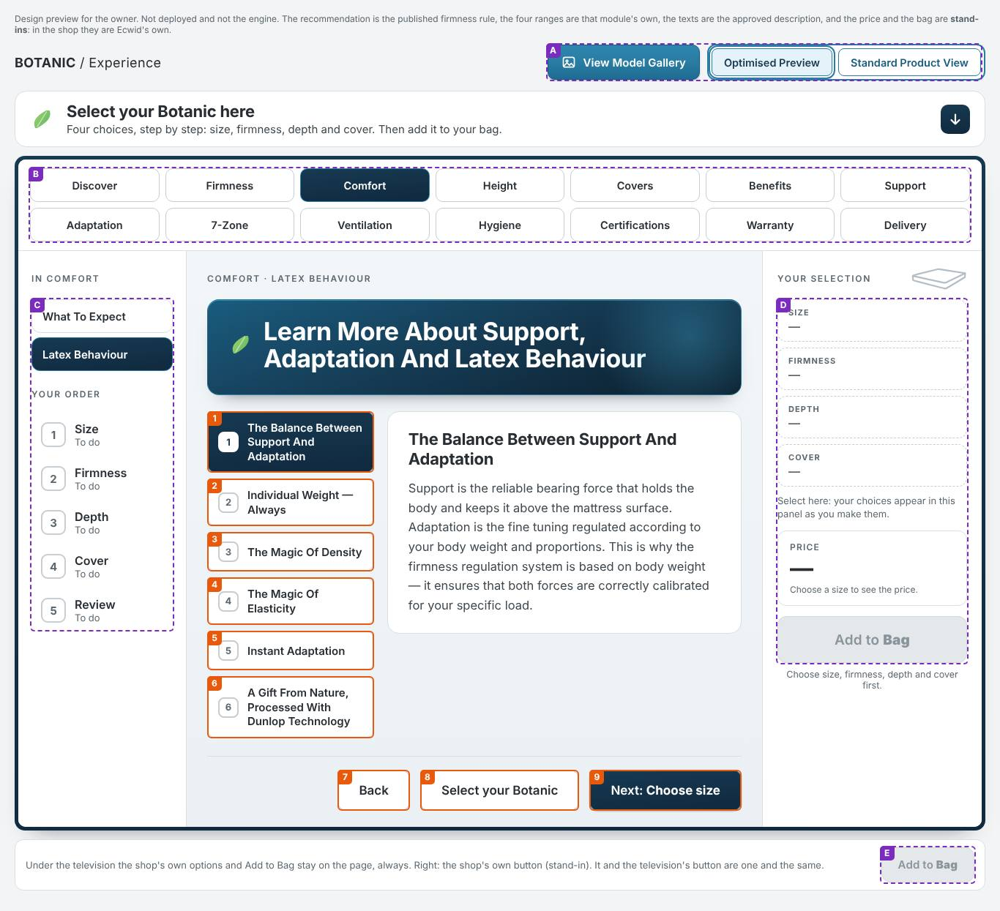

| No. | Button | Kind | What it does today | Leads to | Your decision |
|---|---|---|---|---|---|
| 1 | 1The Balance Between Support And Adaptation | Text part | Shows this part of the text on the right | that part of the text | |
| 2 | 2Individual Weight — Always | Text part | Shows this part of the text on the right | that part of the text | |
| 3 | 3The Magic Of Density | Text part | Shows this part of the text on the right | that part of the text | |
| 4 | 4The Magic Of Elasticity | Text part | Shows this part of the text on the right | that part of the text | |
| 5 | 5Instant Adaptation | Text part | Shows this part of the text on the right | that part of the text | |
| 6 | 6A Gift From Nature, Processed With Dunlop Technology | Text part | Shows this part of the text on the right | that part of the text | |
| 7 | Back | Back | Goes to the previous panel of the whole presentation | the previous panel | |
| 8 | Select your Botanic | Select your Botanic | Goes to step 1 of the order (Size) | that step | |
| 9 | Next: Choose size | Next | Goes to the next panel of the whole presentation | the next panel | |

### height-why

**Height · Why Height Matters**

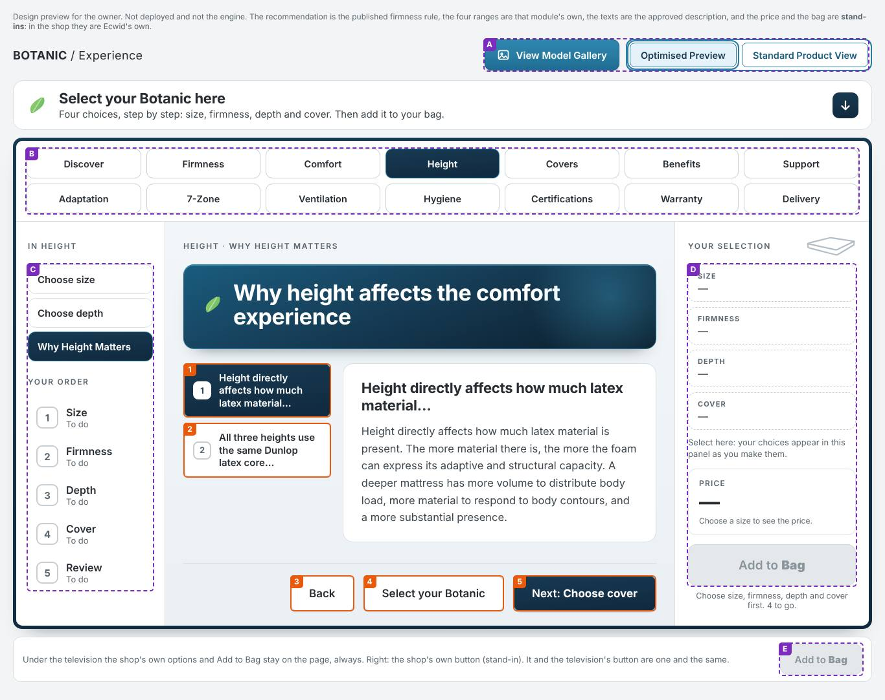

| No. | Button | Kind | What it does today | Leads to | Your decision |
|---|---|---|---|---|---|
| 1 | 1Height directly affects how much latex material… | Text part | Shows this part of the text on the right | that part of the text | |
| 2 | 2All three heights use the same Dunlop latex core… | Text part | Shows this part of the text on the right | that part of the text | |
| 3 | Back | Back | Goes to the previous panel of the whole presentation | the previous panel | |
| 4 | Select your Botanic | Select your Botanic | Goes to step 1 of the order (Size) | that step | |
| 5 | Next: Choose cover | Next | Goes to the next panel of the whole presentation | the next panel | |

### covers-system

**Covers · Cover System**

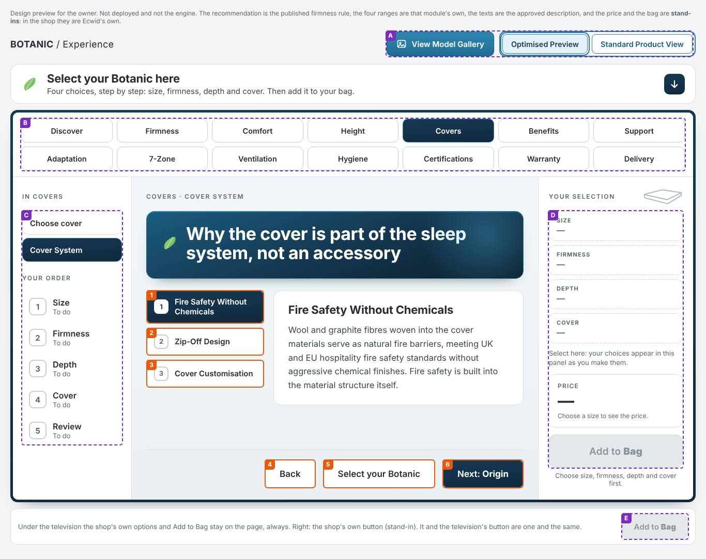

| No. | Button | Kind | What it does today | Leads to | Your decision |
|---|---|---|---|---|---|
| 1 | 1Fire Safety Without Chemicals | Text part | Shows this part of the text on the right | that part of the text | |
| 2 | 2Zip-Off Design | Text part | Shows this part of the text on the right | that part of the text | |
| 3 | 3Cover Customisation | Text part | Shows this part of the text on the right | that part of the text | |
| 4 | Back | Back | Goes to the previous panel of the whole presentation | the previous panel | |
| 5 | Select your Botanic | Select your Botanic | Goes to step 1 of the order (Size) | that step | |
| 6 | Next: Origin | Next | Goes to the next panel of the whole presentation | the next panel | |

### benefits-origin

**Benefits · Origin**

| No. | Button | Kind | What it does today | Leads to | Your decision |
|---|---|---|---|---|---|
| 1 | Back | Back | Goes to the previous panel of the whole presentation | the previous panel | |
| 2 | Select your Botanic | Select your Botanic | Goes to step 1 of the order (Size) | that step | |
| 3 | Next: Why Latex | Next | Goes to the next panel of the whole presentation | the next panel | |

### benefits-why

**Benefits · Why Latex**

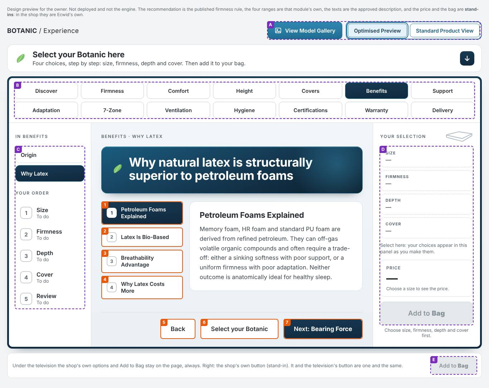

| No. | Button | Kind | What it does today | Leads to | Your decision |
|---|---|---|---|---|---|
| 1 | 1Petroleum Foams Explained | Text part | Shows this part of the text on the right | that part of the text | |
| 2 | 2Latex Is Bio-Based | Text part | Shows this part of the text on the right | that part of the text | |
| 3 | 3Breathability Advantage | Text part | Shows this part of the text on the right | that part of the text | |
| 4 | 4Why Latex Costs More | Text part | Shows this part of the text on the right | that part of the text | |
| 5 | Back | Back | Goes to the previous panel of the whole presentation | the previous panel | |
| 6 | Select your Botanic | Select your Botanic | Goes to step 1 of the order (Size) | that step | |
| 7 | Next: Bearing Force | Next | Goes to the next panel of the whole presentation | the next panel | |

### support-bearing

**Support · Bearing Force**

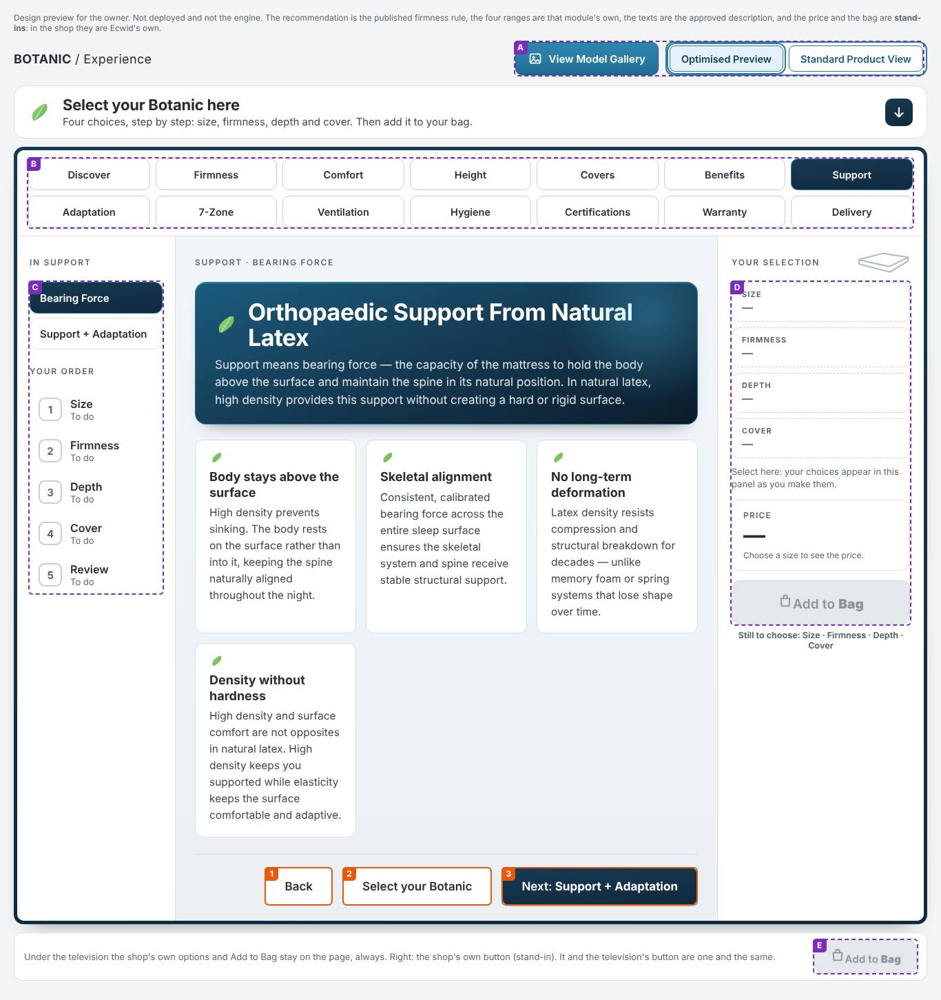

| No. | Button | Kind | What it does today | Leads to | Your decision |
|---|---|---|---|---|---|
| 1 | Back | Back | Goes to the previous panel of the whole presentation | the previous panel | |
| 2 | Select your Botanic | Select your Botanic | Goes to step 1 of the order (Size) | that step | |
| 3 | Next: Support + Adaptation | Next | Goes to the next panel of the whole presentation | the next panel | |

### support-together

**Support · Support + Adaptation**

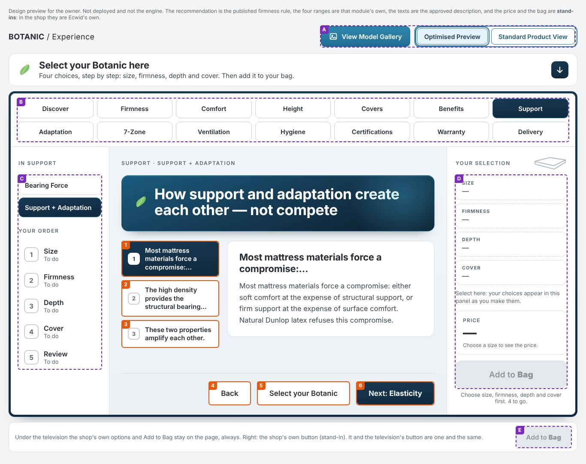

| No. | Button | Kind | What it does today | Leads to | Your decision |
|---|---|---|---|---|---|
| 1 | 1Most mattress materials force a compromise:… | Text part | Shows this part of the text on the right | that part of the text | |
| 2 | 2The high density provides the structural bearing… | Text part | Shows this part of the text on the right | that part of the text | |
| 3 | 3These two properties amplify each other. | Text part | Shows this part of the text on the right | that part of the text | |
| 4 | Back | Back | Goes to the previous panel of the whole presentation | the previous panel | |
| 5 | Select your Botanic | Select your Botanic | Goes to step 1 of the order (Size) | that step | |
| 6 | Next: Elasticity | Next | Goes to the next panel of the whole presentation | the next panel | |

### adaptation-elasticity

**Adaptation · Elasticity**

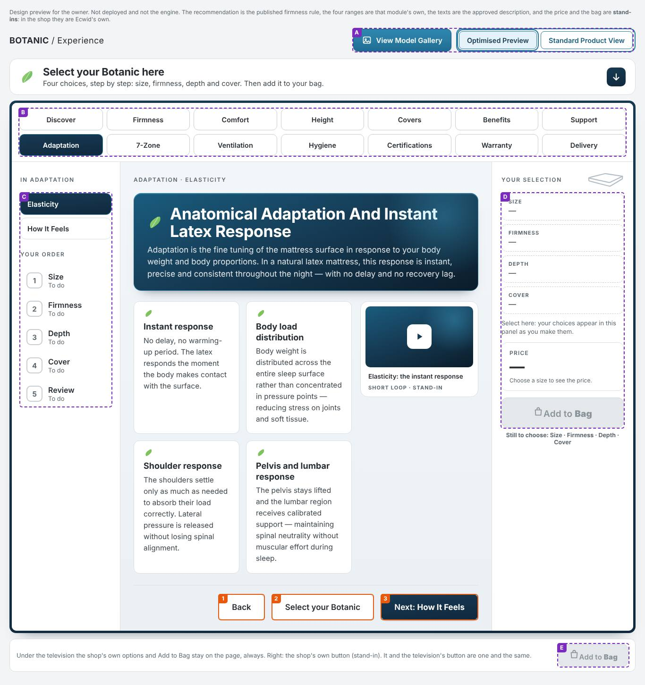

| No. | Button | Kind | What it does today | Leads to | Your decision |
|---|---|---|---|---|---|
| 1 | Back | Back | Goes to the previous panel of the whole presentation | the previous panel | |
| 2 | Select your Botanic | Select your Botanic | Goes to step 1 of the order (Size) | that step | |
| 3 | Next: How It Feels | Next | Goes to the next panel of the whole presentation | the next panel | |

### adaptation-feel

**Adaptation · How It Feels**

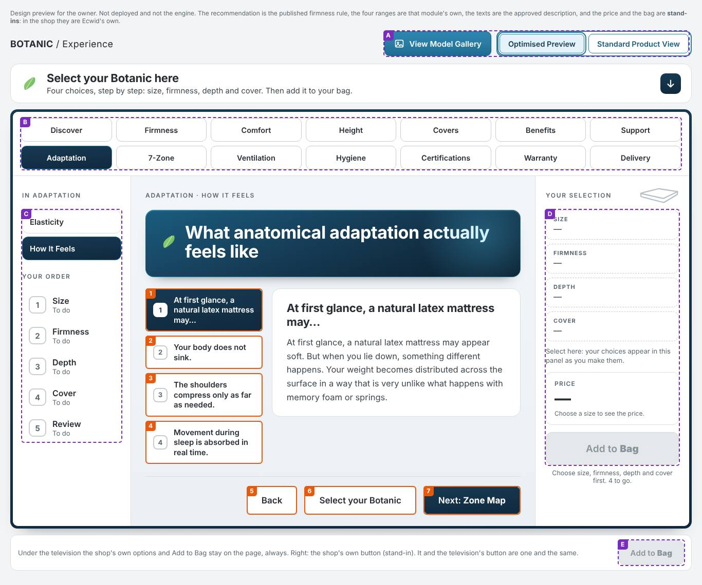

| No. | Button | Kind | What it does today | Leads to | Your decision |
|---|---|---|---|---|---|
| 1 | 1At first glance, a natural latex mattress may… | Text part | Shows this part of the text on the right | that part of the text | |
| 2 | 2Your body does not sink. | Text part | Shows this part of the text on the right | that part of the text | |
| 3 | 3The shoulders compress only as far as needed. | Text part | Shows this part of the text on the right | that part of the text | |
| 4 | 4Movement during sleep is absorbed in real time. | Text part | Shows this part of the text on the right | that part of the text | |
| 5 | Back | Back | Goes to the previous panel of the whole presentation | the previous panel | |
| 6 | Select your Botanic | Select your Botanic | Goes to step 1 of the order (Size) | that step | |
| 7 | Next: Zone Map | Next | Goes to the next panel of the whole presentation | the next panel | |

### zones-map

**7-Zone · Zone Map**

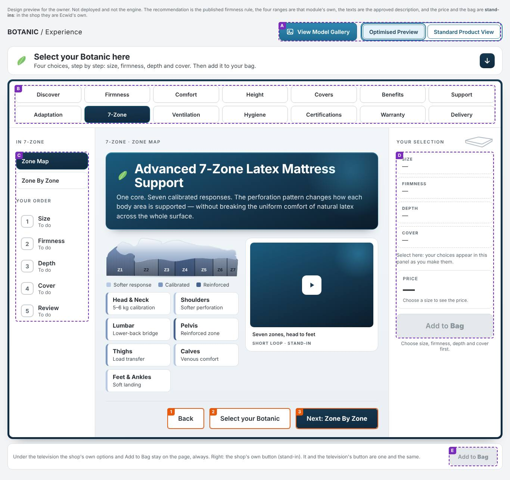

| No. | Button | Kind | What it does today | Leads to | Your decision |
|---|---|---|---|---|---|
| 1 | Back | Back | Goes to the previous panel of the whole presentation | the previous panel | |
| 2 | Select your Botanic | Select your Botanic | Goes to step 1 of the order (Size) | that step | |
| 3 | Next: Zone By Zone | Next | Goes to the next panel of the whole presentation | the next panel | |

### zones-detail

**7-Zone · Zone By Zone**

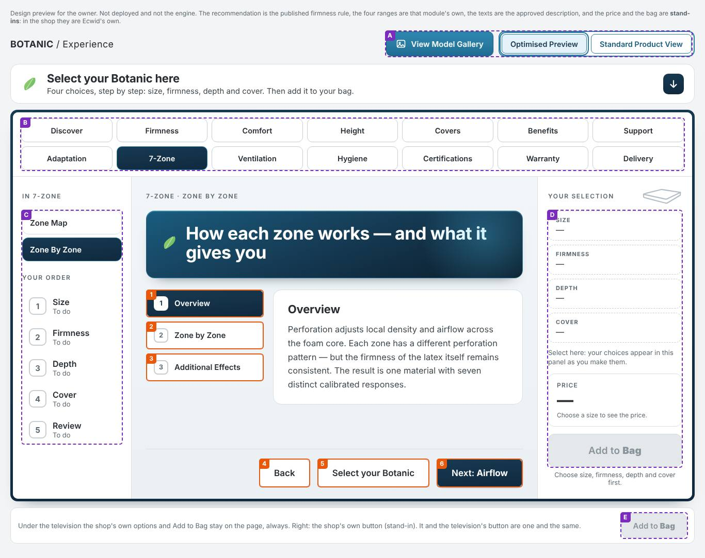

| No. | Button | Kind | What it does today | Leads to | Your decision |
|---|---|---|---|---|---|
| 1 | 1Overview | Text part | Shows this part of the text on the right | that part of the text | |
| 2 | 2Zone by Zone | Text part | Shows this part of the text on the right | that part of the text | |
| 3 | 3Additional Effects | Text part | Shows this part of the text on the right | that part of the text | |
| 4 | Back | Back | Goes to the previous panel of the whole presentation | the previous panel | |
| 5 | Select your Botanic | Select your Botanic | Goes to step 1 of the order (Size) | that step | |
| 6 | Next: Airflow | Next | Goes to the next panel of the whole presentation | the next panel | |

### ventilation-airflow

**Ventilation · Airflow**

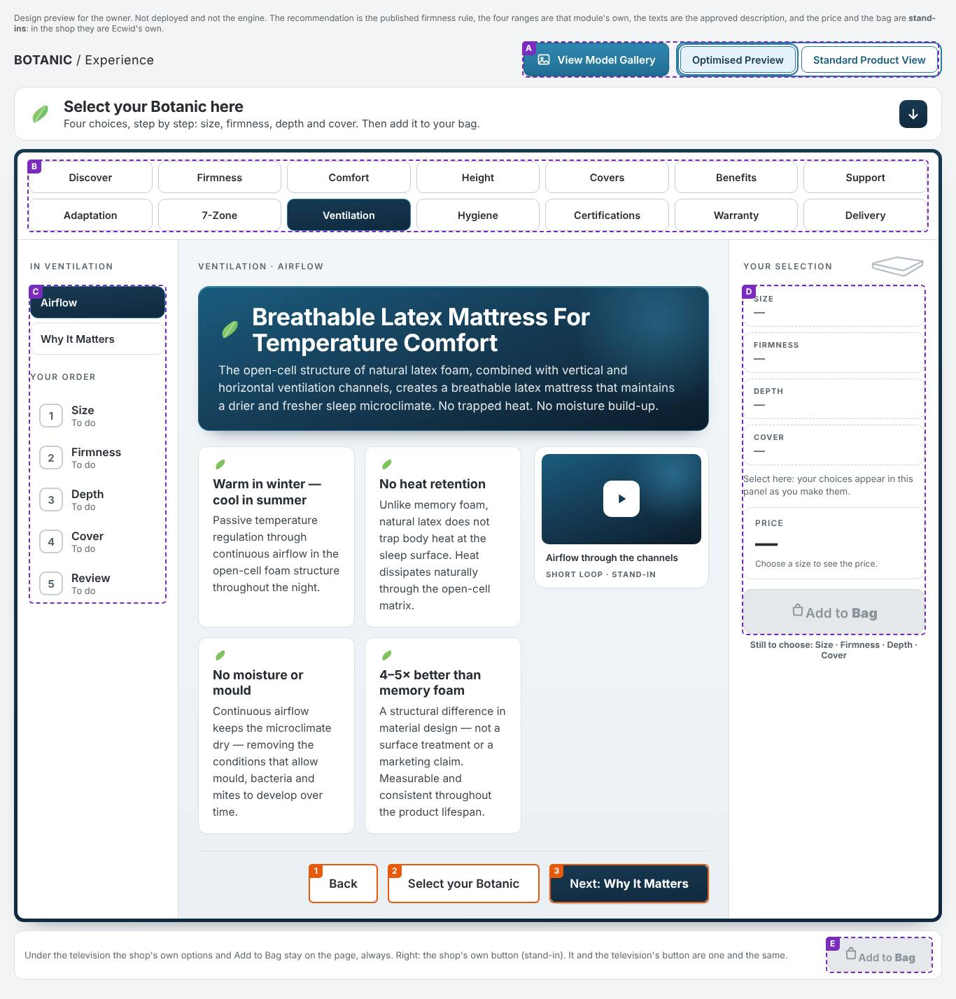

| No. | Button | Kind | What it does today | Leads to | Your decision |
|---|---|---|---|---|---|
| 1 | Back | Back | Goes to the previous panel of the whole presentation | the previous panel | |
| 2 | Select your Botanic | Select your Botanic | Goes to step 1 of the order (Size) | that step | |
| 3 | Next: Why It Matters | Next | Goes to the next panel of the whole presentation | the next panel | |

### ventilation-sleep

**Ventilation · Why It Matters**

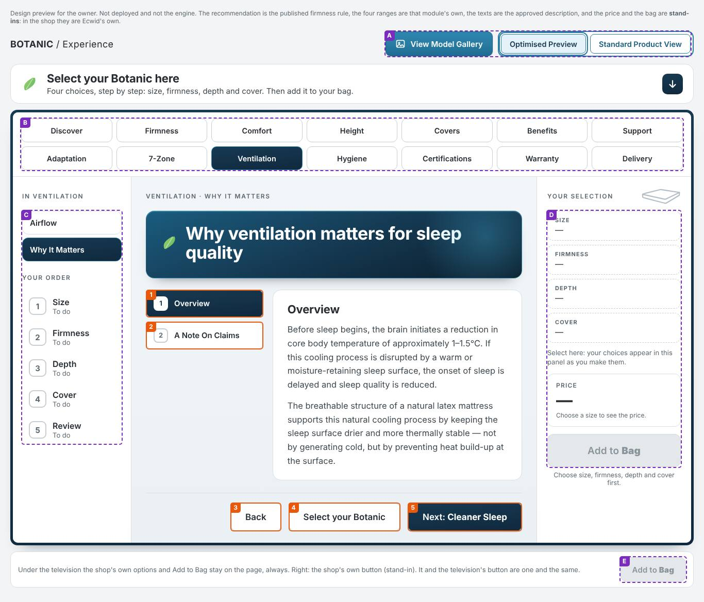

| No. | Button | Kind | What it does today | Leads to | Your decision |
|---|---|---|---|---|---|
| 1 | 1Overview | Text part | Shows this part of the text on the right | that part of the text | |
| 2 | 2A Note On Claims | Text part | Shows this part of the text on the right | that part of the text | |
| 3 | Back | Back | Goes to the previous panel of the whole presentation | the previous panel | |
| 4 | Select your Botanic | Select your Botanic | Goes to step 1 of the order (Size) | that step | |
| 5 | Next: Cleaner Sleep | Next | Goes to the next panel of the whole presentation | the next panel | |

### hygiene-clean

**Hygiene · Cleaner Sleep**

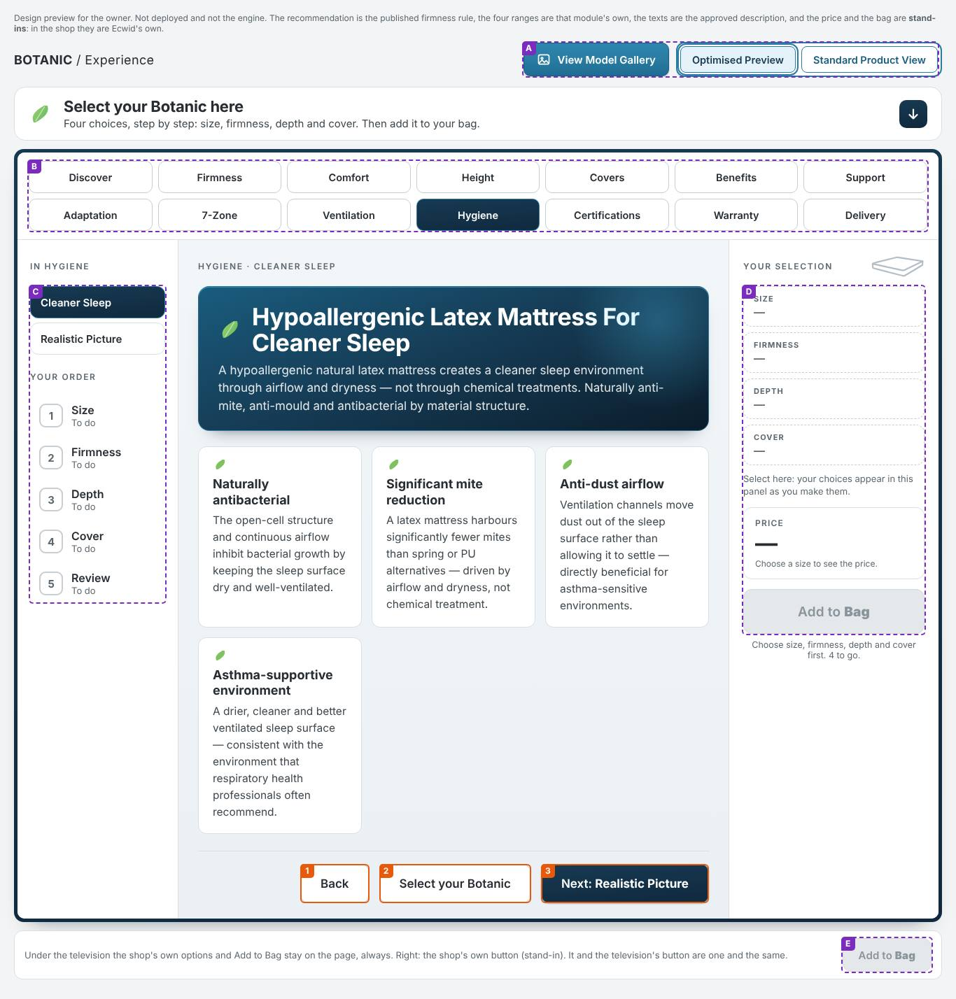

| No. | Button | Kind | What it does today | Leads to | Your decision |
|---|---|---|---|---|---|
| 1 | Back | Back | Goes to the previous panel of the whole presentation | the previous panel | |
| 2 | Select your Botanic | Select your Botanic | Goes to step 1 of the order (Size) | that step | |
| 3 | Next: Realistic Picture | Next | Goes to the next panel of the whole presentation | the next panel | |

### hygiene-picture

**Hygiene · Realistic Picture**

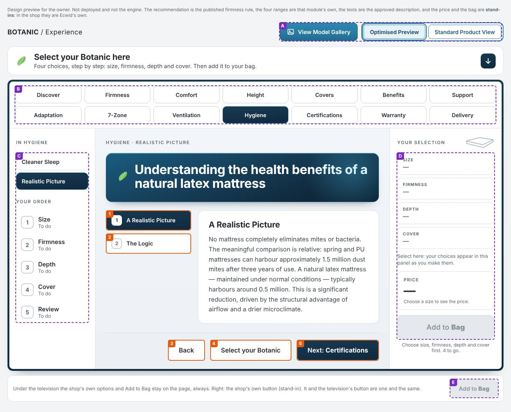

| No. | Button | Kind | What it does today | Leads to | Your decision |
|---|---|---|---|---|---|
| 1 | 1A Realistic Picture | Text part | Shows this part of the text on the right | that part of the text | |
| 2 | 2The Logic | Text part | Shows this part of the text on the right | that part of the text | |
| 3 | Back | Back | Goes to the previous panel of the whole presentation | the previous panel | |
| 4 | Select your Botanic | Select your Botanic | Goes to step 1 of the order (Size) | that step | |
| 5 | Next: Certifications | Next | Goes to the next panel of the whole presentation | the next panel | |

### certs-bodies

**Certifications · Certifications**

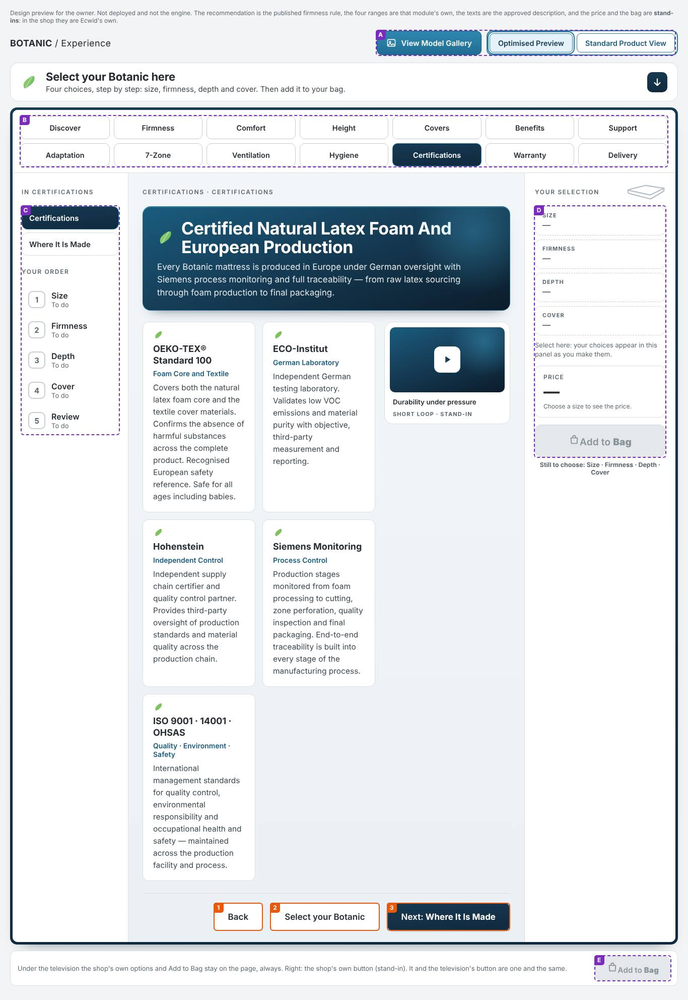

| No. | Button | Kind | What it does today | Leads to | Your decision |
|---|---|---|---|---|---|
| 1 | Back | Back | Goes to the previous panel of the whole presentation | the previous panel | |
| 2 | Select your Botanic | Select your Botanic | Goes to step 1 of the order (Size) | that step | |
| 3 | Next: Where It Is Made | Next | Goes to the next panel of the whole presentation | the next panel | |

### certs-made

**Certifications · Where It Is Made**

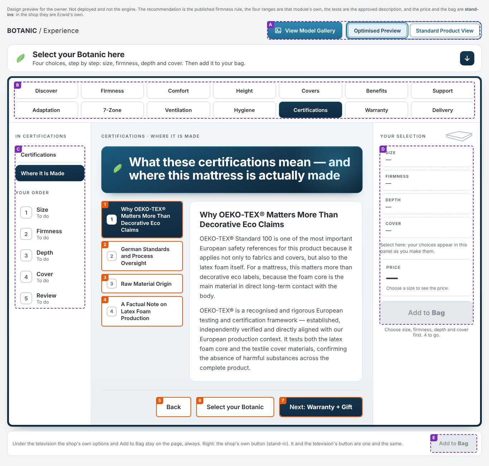

| No. | Button | Kind | What it does today | Leads to | Your decision |
|---|---|---|---|---|---|
| 1 | 1Why OEKO-TEX® Matters More Than Decorative Eco Claims | Text part | Shows this part of the text on the right | that part of the text | |
| 2 | 2German Standards and Process Oversight | Text part | Shows this part of the text on the right | that part of the text | |
| 3 | 3Raw Material Origin | Text part | Shows this part of the text on the right | that part of the text | |
| 4 | 4A Factual Note on Latex Foam Production | Text part | Shows this part of the text on the right | that part of the text | |
| 5 | Back | Back | Goes to the previous panel of the whole presentation | the previous panel | |
| 6 | Select your Botanic | Select your Botanic | Goes to step 1 of the order (Size) | that step | |
| 7 | Next: Warranty + Gift | Next | Goes to the next panel of the whole presentation | the next panel | |

### warranty-cover

**Warranty · Warranty + Gift**

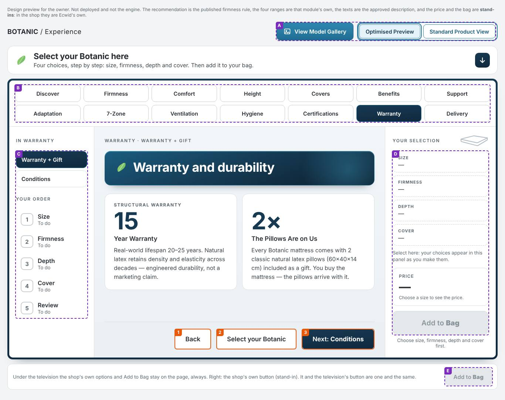

| No. | Button | Kind | What it does today | Leads to | Your decision |
|---|---|---|---|---|---|
| 1 | Back | Back | Goes to the previous panel of the whole presentation | the previous panel | |
| 2 | Select your Botanic | Select your Botanic | Goes to step 1 of the order (Size) | that step | |
| 3 | Next: Conditions | Next | Goes to the next panel of the whole presentation | the next panel | |

### warranty-conditions

**Warranty · Conditions**

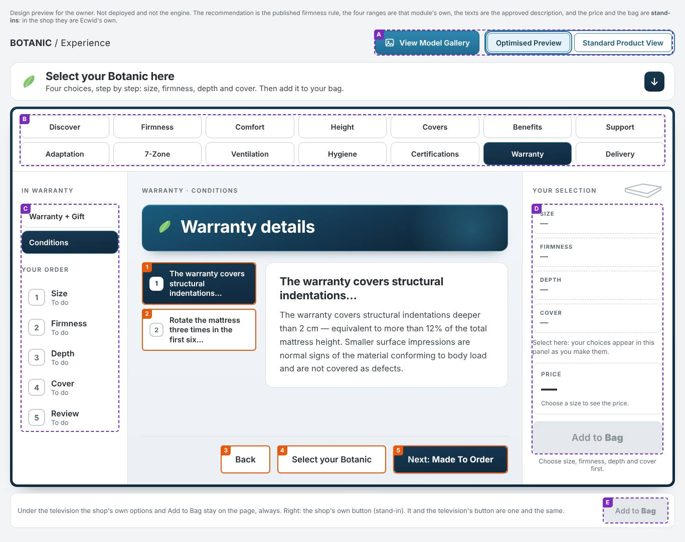

| No. | Button | Kind | What it does today | Leads to | Your decision |
|---|---|---|---|---|---|
| 1 | 1The warranty covers structural indentations… | Text part | Shows this part of the text on the right | that part of the text | |
| 2 | 2Rotate the mattress three times in the first six… | Text part | Shows this part of the text on the right | that part of the text | |
| 3 | Back | Back | Goes to the previous panel of the whole presentation | the previous panel | |
| 4 | Select your Botanic | Select your Botanic | Goes to step 1 of the order (Size) | that step | |
| 5 | Next: Made To Order | Next | Goes to the next panel of the whole presentation | the next panel | |

### delivery-made

**Delivery · Made To Order**

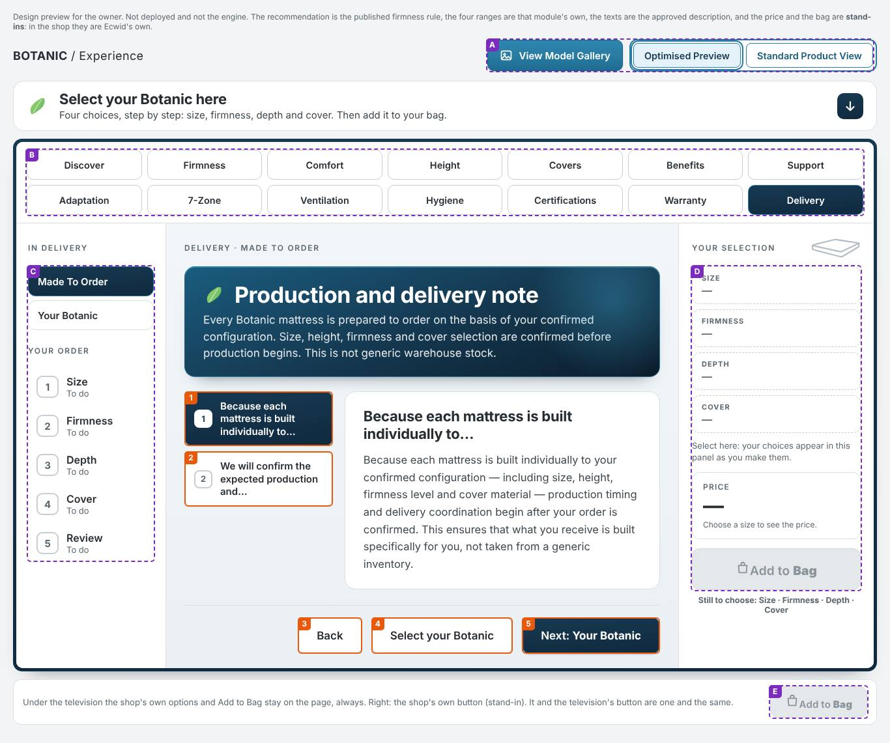

| No. | Button | Kind | What it does today | Leads to | Your decision |
|---|---|---|---|---|---|
| 1 | 1Because each mattress is built individually to… | Text part | Shows this part of the text on the right | that part of the text | |
| 2 | 2We will confirm the expected production and… | Text part | Shows this part of the text on the right | that part of the text | |
| 3 | Back | Back | Goes to the previous panel of the whole presentation | the previous panel | |
| 4 | Select your Botanic | Select your Botanic | Goes to step 1 of the order (Size) | that step | |
| 5 | Next: Your Botanic | Next | Goes to the next panel of the whole presentation | the next panel | |

---
269 numbered buttons over 38 screens, plus the always-present groups. Regenerate after any change: `node tools/build-tv-design-preview.mjs && NODE_PATH=$(npm root -g) node tools/tv-button-catalogue.mjs`. The buttons of today's live television (before this design) are in `docs/TV-BUTTON-MAP.md`.
