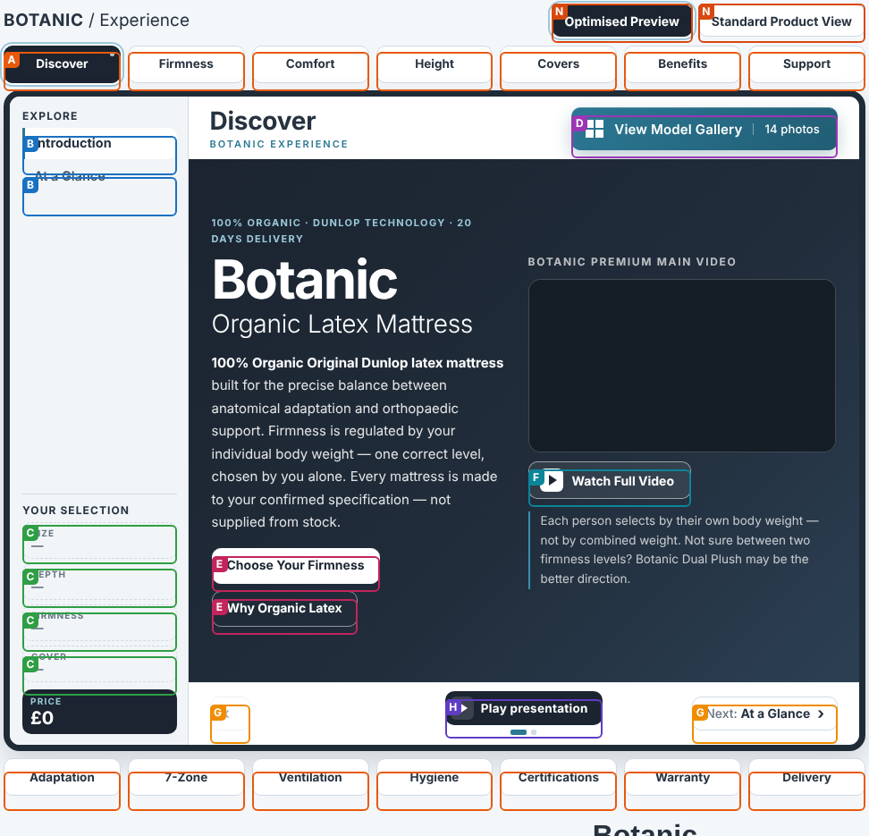
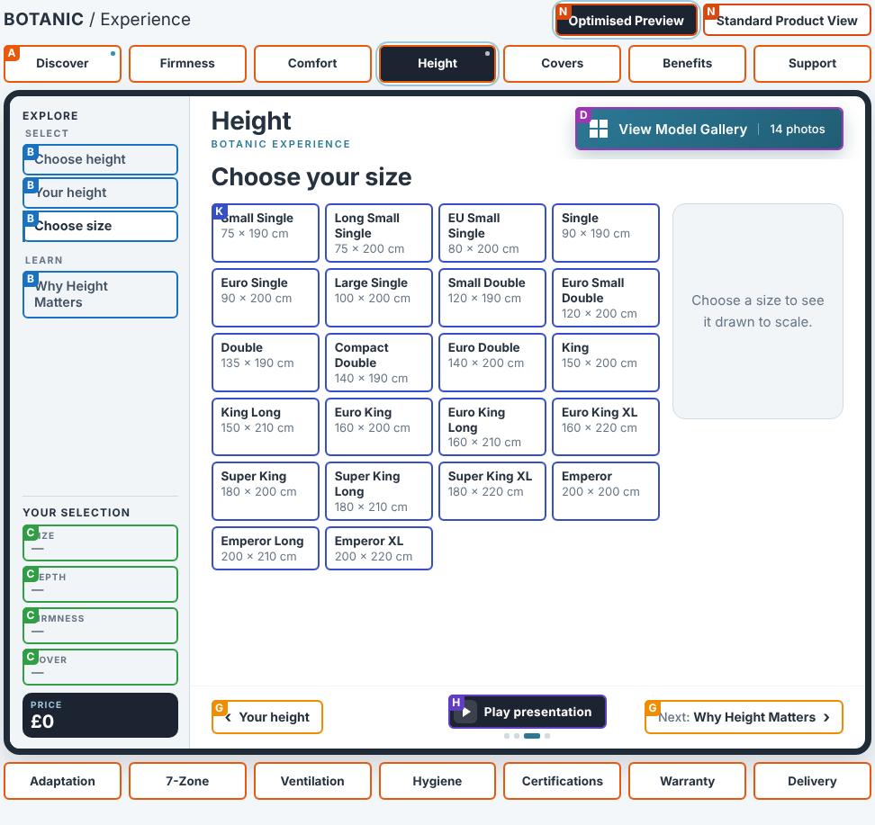
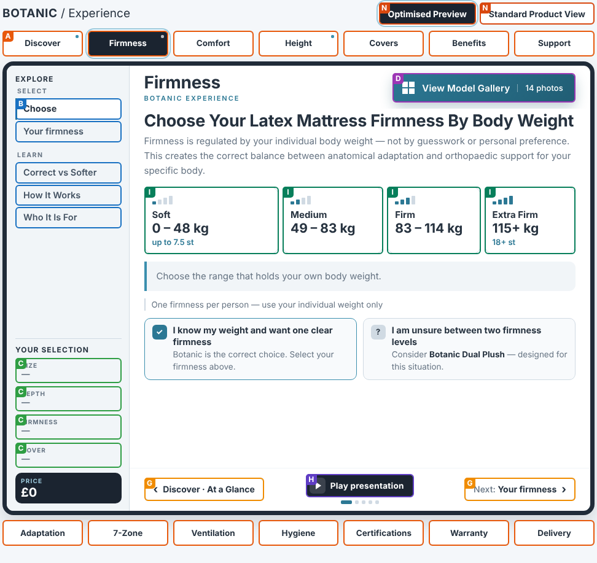
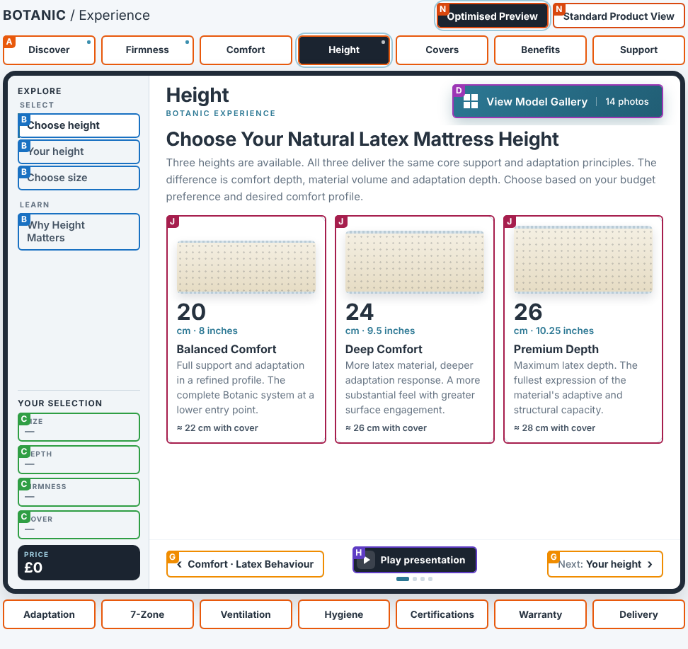
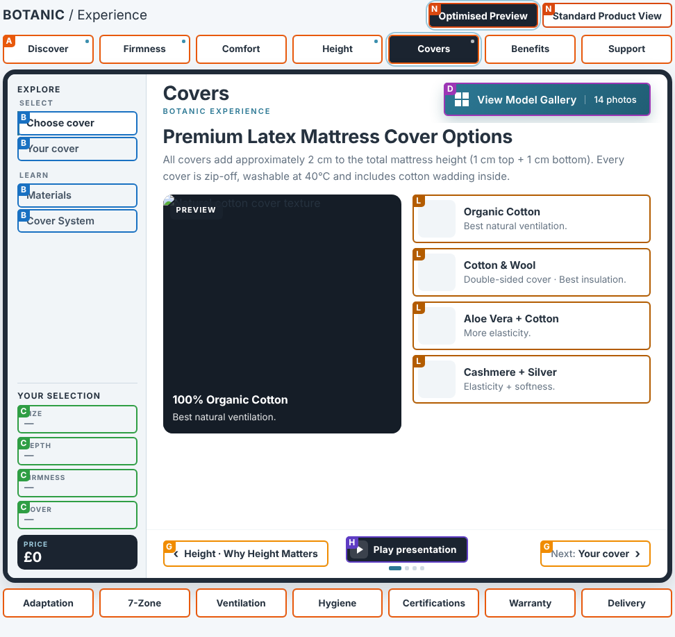
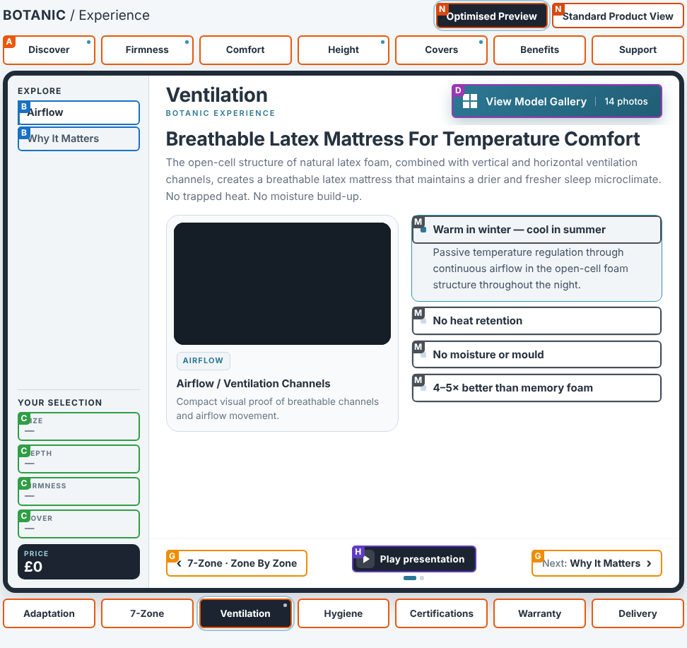
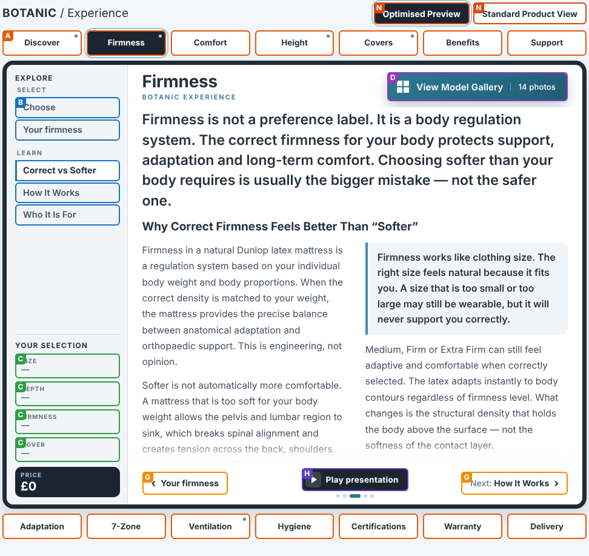
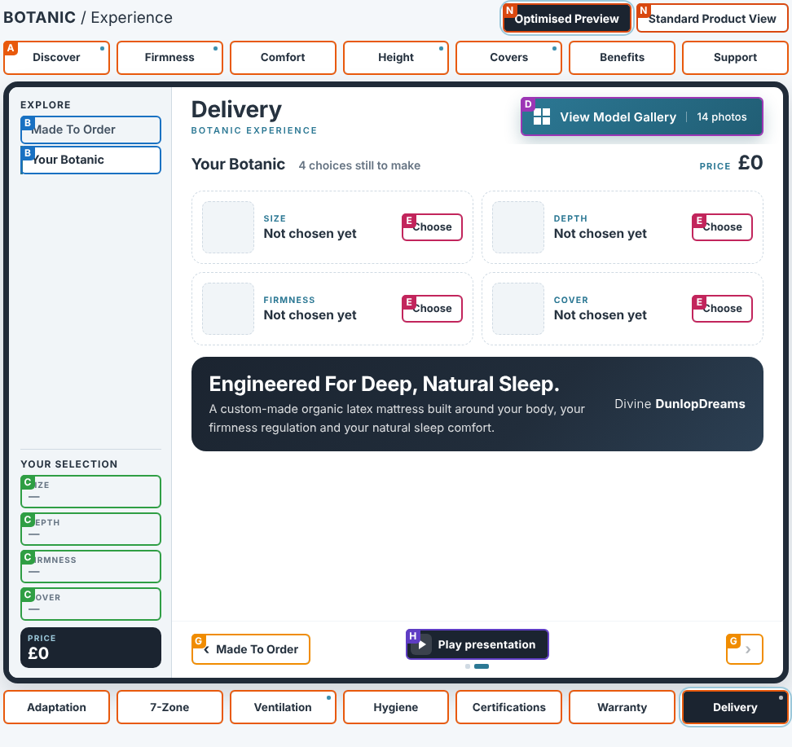

# The television's buttons today: a preview to build on

This is **what the large-screen television does now**, drawn from the real engine (on the simulated store page; not a live store). Every group of buttons is outlined in its own colour and marked with a letter; **the same kind of button has the same letter on every screen**. It is the base for the owner's specification: pictures, diagrams or changes added on top of it go into `docs/TV-BUTTON-SPEC.md`.

Pictures are in `docs/tv-preview/`: one for each screen and each device size (iPad Pro 12.9 inch portrait and landscape, and a desktop monitor). Regenerate them with `node tools/build-embed.mjs && NODE_PATH=$(npm root -g) node tools/tv-button-map.mjs`.

## The kinds of button (the same letters everywhere)

| Letter | Kind | Role today | Orientation today |
|---|---|---|---|
| **A** | Chapter button | Navigation | to a chapter (→) |
| **B** | Panel tab | Navigation inside the chapter | sideways |
| **C** | Selection chip (Size, Depth, Firmness, Cover) | Summary and shortcut | to the screen where that choice is made (→) |
| **D** | View Model Gallery | Media: the product photographs inside the monitor | open (↗ in the monitor) |
| **E** | Action on a screen | Primary or secondary action | forward (→) |
| **F** | Play the full video | Media | play (▶) |
| **G** | Previous / Next | Navigation | back (←) / forward (→) |
| **H** | Play or pause the presentation | Media: the automatic tour | play (▶) / pause |
| **I** | Firmness choice | Selection: sets the store's own control | none (a choice) |
| **J** | Depth choice | Selection: sets the store's own control | none (a choice) |
| **K** | Size choice | Selection: sets the store's own control | none (a choice) |
| **L** | Cover choice | Selection: sets the store's own control | none (a choice) |
| **M** | Point heading (expands) | Disclosure | open (+) / close (×) |
| **N** | Optimised Preview / Standard Product View | View switch | to the store's own page and back |

## The screens

### Opening: the introduction (`discover/intro`)

| Letter | Kind | How many | What it says today |
|---|---|---|---|
| **A** | Chapter button | 14 | Discover; Firmness; Comfort; Height; Covers |
| **B** | Panel tab | 2 | Introduction; At a Glance |
| **C** | Selection chip (Size, Depth, Firmness, Cover) | 4 | SIZE —; DEPTH —; FIRMNESS —; COVER — |
| **D** | View Model Gallery | 1 | View Model Gallery, 14 photos |
| **E** | Action on a screen | 2 | Choose Your Firmness; Why Organic Latex |
| **F** | Play the full video | 1 | Watch Full Video |
| **G** | Previous / Next | 2 | Previous; Next: At a Glance |
| **H** | Play or pause the presentation | 1 | Play presentation |
| **N** | Optimised Preview / Standard Product View | 2 | Optimised Preview; Standard Product View |

Other sizes: [iPad Pro landscape](tv-preview/ipad-pro-landscape-discover-intro.png), [desktop](tv-preview/desktop-discover-intro.png)

### Choose size (`height/sizes`)

| Letter | Kind | How many | What it says today |
|---|---|---|---|
| **A** | Chapter button | 14 | Discover; Firmness; Comfort; Height; Covers |
| **B** | Panel tab | 4 | Choose height; Your height; Choose size; Why Height Matters |
| **C** | Selection chip (Size, Depth, Firmness, Cover) | 4 | SIZE —; DEPTH —; FIRMNESS —; COVER — |
| **D** | View Model Gallery | 1 | View Model Gallery, 14 photos |
| **G** | Previous / Next | 2 | Previous: Your height; Next: Why Height Matters |
| **H** | Play or pause the presentation | 1 | Play presentation |
| **K** | Size choice | 22 | Small Single 75 × 190 cm; Long Small Single 75 × 200 cm; EU Small Single 80 × 200 cm; Single 90 × 190 cm; Euro Single 90 × 200 cm |
| **N** | Optimised Preview / Standard Product View | 2 | Optimised Preview; Standard Product View |

Other sizes: [iPad Pro landscape](tv-preview/ipad-pro-landscape-height-sizes.png), [desktop](tv-preview/desktop-height-sizes.png)

### Choose firmness (`firmness/choose`)

| Letter | Kind | How many | What it says today |
|---|---|---|---|
| **A** | Chapter button | 14 | Discover; Firmness; Comfort; Height; Covers |
| **B** | Panel tab | 5 | Choose; Your firmness; Correct vs Softer; How It Works; Who It Is For |
| **C** | Selection chip (Size, Depth, Firmness, Cover) | 4 | SIZE —; DEPTH —; FIRMNESS —; COVER — |
| **D** | View Model Gallery | 1 | View Model Gallery, 14 photos |
| **G** | Previous / Next | 2 | Previous: Discover · At a Glance; Next: Your firmness |
| **H** | Play or pause the presentation | 1 | Play presentation |
| **I** | Firmness choice | 4 | Soft 0 – 48 kg up to 7.5 st; Medium 49 – 83 kg; Firm 83 – 114 kg; Extra Firm 115+ kg 18+ st |
| **N** | Optimised Preview / Standard Product View | 2 | Optimised Preview; Standard Product View |

Other sizes: [iPad Pro landscape](tv-preview/ipad-pro-landscape-firmness-choose.png), [desktop](tv-preview/desktop-firmness-choose.png)

### Choose depth (`height/heights`)

| Letter | Kind | How many | What it says today |
|---|---|---|---|
| **A** | Chapter button | 14 | Discover; Firmness; Comfort; Height; Covers |
| **B** | Panel tab | 4 | Choose height; Your height; Choose size; Why Height Matters |
| **C** | Selection chip (Size, Depth, Firmness, Cover) | 4 | SIZE —; DEPTH —; FIRMNESS —; COVER — |
| **D** | View Model Gallery | 1 | View Model Gallery, 14 photos |
| **G** | Previous / Next | 2 | Previous: Comfort · Latex Behaviour; Next: Your height |
| **H** | Play or pause the presentation | 1 | Play presentation |
| **J** | Depth choice | 3 | 20 cm · 8 inches Balanced Comfort Full s; 24 cm · 9.5 inches Deep Comfort More lat; 26 cm · 10.25 inches Premium Depth Maxim |
| **N** | Optimised Preview / Standard Product View | 2 | Optimised Preview; Standard Product View |

Other sizes: [iPad Pro landscape](tv-preview/ipad-pro-landscape-height-heights.png), [desktop](tv-preview/desktop-height-heights.png)

### Choose cover (`covers/choose`)

| Letter | Kind | How many | What it says today |
|---|---|---|---|
| **A** | Chapter button | 14 | Discover; Firmness; Comfort; Height; Covers |
| **B** | Panel tab | 4 | Choose cover; Your cover; Materials; Cover System |
| **C** | Selection chip (Size, Depth, Firmness, Cover) | 4 | SIZE —; DEPTH —; FIRMNESS —; COVER — |
| **D** | View Model Gallery | 1 | View Model Gallery, 14 photos |
| **G** | Previous / Next | 2 | Previous: Height · Why Height Matters; Next: Your cover |
| **H** | Play or pause the presentation | 1 | Play presentation |
| **L** | Cover choice | 4 | Organic Cotton Best natural ventilation.; Cotton & Wool Double-sided cover · Best ; Aloe Vera + Cotton More elasticity.; Cashmere + Silver Elasticity + softness. |
| **N** | Optimised Preview / Standard Product View | 2 | Optimised Preview; Standard Product View |

Other sizes: [iPad Pro landscape](tv-preview/ipad-pro-landscape-covers-choose.png), [desktop](tv-preview/desktop-covers-choose.png)

### A "points" screen (ventilation) (`ventilation/airflow`)

| Letter | Kind | How many | What it says today |
|---|---|---|---|
| **A** | Chapter button | 14 | Discover; Firmness; Comfort; Height; Covers |
| **B** | Panel tab | 2 | Airflow; Why It Matters |
| **C** | Selection chip (Size, Depth, Firmness, Cover) | 4 | SIZE —; DEPTH —; FIRMNESS —; COVER — |
| **D** | View Model Gallery | 1 | View Model Gallery, 14 photos |
| **G** | Previous / Next | 2 | Previous: 7-Zone · Zone By Zone; Next: Why It Matters |
| **H** | Play or pause the presentation | 1 | Play presentation |
| **M** | Point heading (expands) | 4 | Warm in winter — cool in summer; No heat retention; No moisture or mould; 4–5× better than memory foam |
| **N** | Optimised Preview / Standard Product View | 2 | Optimised Preview; Standard Product View |

Other sizes: [iPad Pro landscape](tv-preview/ipad-pro-landscape-ventilation-airflow.png), [desktop](tv-preview/desktop-ventilation-airflow.png)

### A reading screen (firmness principle) (`firmness/principle`)

| Letter | Kind | How many | What it says today |
|---|---|---|---|
| **A** | Chapter button | 14 | Discover; Firmness; Comfort; Height; Covers |
| **B** | Panel tab | 5 | Choose; Your firmness; Correct vs Softer; How It Works; Who It Is For |
| **C** | Selection chip (Size, Depth, Firmness, Cover) | 4 | SIZE —; DEPTH —; FIRMNESS —; COVER — |
| **D** | View Model Gallery | 1 | View Model Gallery, 14 photos |
| **G** | Previous / Next | 2 | Previous: Your firmness; Next: How It Works |
| **H** | Play or pause the presentation | 1 | Play presentation |
| **N** | Optimised Preview / Standard Product View | 2 | Optimised Preview; Standard Product View |

Other sizes: [iPad Pro landscape](tv-preview/ipad-pro-landscape-firmness-principle.png), [desktop](tv-preview/desktop-firmness-principle.png)

### Closing: your Botanic (`delivery/yours`)

| Letter | Kind | How many | What it says today |
|---|---|---|---|
| **A** | Chapter button | 14 | Discover; Firmness; Comfort; Height; Covers |
| **B** | Panel tab | 2 | Made To Order; Your Botanic |
| **C** | Selection chip (Size, Depth, Firmness, Cover) | 4 | SIZE —; DEPTH —; FIRMNESS —; COVER — |
| **D** | View Model Gallery | 1 | View Model Gallery, 14 photos |
| **E** | Action on a screen | 4 | Choose; Choose; Choose; Choose |
| **G** | Previous / Next | 2 | Previous: Made To Order; Next |
| **H** | Play or pause the presentation | 1 | Play presentation |
| **N** | Optimised Preview / Standard Product View | 2 | Optimised Preview; Standard Product View |

Other sizes: [iPad Pro landscape](tv-preview/ipad-pro-landscape-delivery-yours.png), [desktop](tv-preview/desktop-delivery-yours.png)

## What the preview shows that matters for the next decisions

1. **The same 14 chapter buttons (A), the four selection chips (C) and the foot controls (G, H) are on every screen.** The chips already work as shortcuts to the choice they show.
2. **Size is a panel under the chapter "Height", not a step of its own** (22 size buttons, K). Depth is under the same chapter.
3. **The firmness numbers differ between the screen and the store.** The screen shows Soft 0 to 48 kg, Medium 49 to 83, Firm 83 to 114, Extra Firm 115 and over; Ecwid's own labels say up to 47, 48 to 85, 85 to 110 and over 120. A customer sees both on the same page. The owner must choose which is the truth.
4. **Extra Firm is an ordinary choice in the screen today** (a segment like the other three). The owner's decision is that it leads to the specialist model; that is not built yet.
5. **Two switch buttons (N) sit at the top**, "Optimised Preview" and "Standard Product View"; the presentation has one play button (H) and previous or next (G) at the foot.
6. **Every screen has one or more Learn tabs (B)** beside the choosing tab; that is where the explaining sits today.
